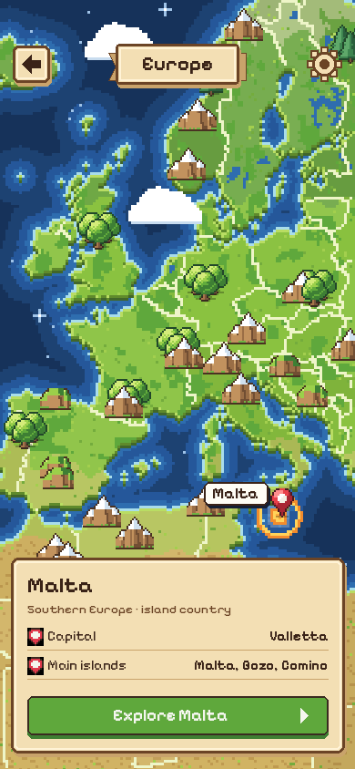
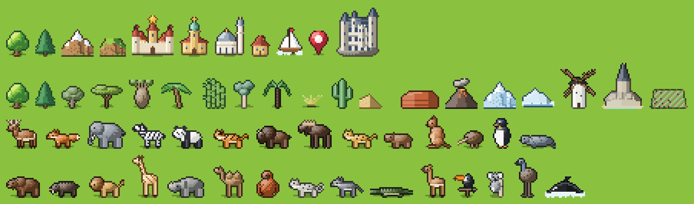

# Pixel World — Art Contract (draft 2.1)

Status: **draft for review, 10 November 2026.** Draft 2.1 replaces the simple icons with detailed, shaded ones drawn at a finer icon pixel. This covers task P2-06 for the continent and country scales that Phase 3 builds. Draft 2 moves the look much closer to the GlobeQuest concept image: night sea, raised game-board land, puzzle-piece countries, fewer and bigger icons, chunkier pixels, and parchment screen furniture. The capital scale is outlined here and gets its full rules in Phase 4. No app renderer implements these rules yet.

| Continent: Europe | Country: Malta |
| --- | --- |
|  |  |
| [Close-up](phase3/europe-continent-detail.png) | [Close-up](phase3/malta-country-detail.png) |

Icon sheet (enlarged). Rows: landmarks and buildings, then each continent's flora and landforms, then its animals. 

Regenerate the mockups with `.venv/bin/python scripts/art/phase3_mockups.py` (set up in the [README](../../README.md#phase-3-design-mockups)). That script is the reference implementation for every rule below. Its `P` table holds the palette tokens. Map icons come from `scripts/art/sprites.py`, which also writes the icon sheet (`.venv/bin/python scripts/art/sprites.py`).

## 1. Rules for every scale

- **One palette.** Every colour is a named token in the script's `P` table. Land greens are the globe's greens. The sea is the globe's deep blue, darkened (see §2). Third-party tiles are remapped to the palette, as `scripts/art/recolor_style_study.py` does for Ninja Adventure.
- **Pixel size.** Terrain pixels are **3 screen points** on phones. Icon pixels are **2 screen points**, so mountains, trees and buildings can carry the concept image's detail without crowding the map. Both are whole numbers, and each layer keeps a single pixel size. Detail comes from finer data, not from bigger pixels.
- **Flat ground, upright objects.** Ground is drawn flat, seen from above, with a raised "game board" edge (§2). Mountains, trees, houses, castles, boats and pins stand upright and are drawn back to front, top of the screen first.
- **Light from the upper left**, the same direction as the globe's lighting. Land is lit on its top and left coasts; upright sprites have a light left face and a shaded right face.
- **Icon shading.** Each material has 3–4 tones: highlight, light, mid and shade. Round forms (tree canopies, the pin) are shaded from a light vector, with a 2×2 ordered dither at tone edges and seeded specks for foliage. Buildings have a lit west column and shaded east columns, and roofs a lit west slope and shaded east slope with a highlight streak.
- **Outlines.** 1 pixel, in a dark shade of each material's own hue:

  | Material | Outline |
  | --- | --- |
  | Foliage | `#22472A` |
  | Rock | `#4A3222` |
  | Walls | `#4E4038` |
  | Roofs | `#5A1E28` |
  | Wood | `#3A2A20` |
  | Pin | `#4A1A20` |

  Ground has no outlines; edges come from colour steps.
- **Ground shadows.** Every icon sits on a soft shadow: black at 27% opacity, an ellipse about as wide as the icon.
- **Few, big icons.** A screen holds roughly 10–30 icons, not a carpet of them. Sizes in icon pixels, then points:

  | Icon | Icon pixels | Points |
  | --- | --- | --- |
  | Tree | 15×17 | 30×34 |
  | Pine | 13×18 | 26×36 |
  | Mountain | 21×18 | 42×36 |
  | Hill | 17×12 | 34×24 |
  | Castle | 27×24 | 54×48 |
  | Church | 19×25 | 38×50 |
  | House | 13×13 | 26×26 |
  | Sailboat | 17×19 | 34×38 |
  | Pin | 13×17 | 26×34 |
  | Flora and landforms | 13–25 wide, 11–21 tall | 26–50 wide |
  | Animals | 14–26 wide, 12–22 tall | 28–52 wide |

  Flora and landforms: oak, pine, olive, acacia, baobab, palm, bamboo, eucalyptus, tree fern, tall grass, saguaro, dune, red rock, volcano, glacier, iceberg. Animals, all in profile facing left: deer, fox, brown bear, wild boar, elephant, zebra, lion, giraffe, rhinoceros, panda, tiger, Bactrian camel, orangutan, snow leopard, bison, moose, gray wolf, alligator, jaguar, capybara, guanaco, toucan, kangaroo, kiwi, koala, emu, penguin, seal, orca. Fine grass blades are the one material without outlines, since outlines would fill the gaps between blades.
- **Stable decoration.** Noise, sparkles, clouds, boats and tree positions are seeded from longitude and latitude, never from screen position, so nothing shimmers while panning. Decoration is illustrative: it never adds named places.
- **Text and chips** are normal text in screen space, not baked into the art. Use Pixelify Sans. The selected place gets a red pin and a white name chip with an ink outline; selection never relies on colour alone.
- **Attribution.** OSM-derived scales show `© OpenStreetMap contributors` in the system font, because Pixelify Sans has no © glyph.

## 2. Sea and coasts (all scales)

The sea is a **night sea**, so the map stays continuous with the starry space scene the globe sits in. Water colour depends on distance from land, measured in **art pixels, not kilometres**, so the coast ring looks the same at every zoom.

| Distance (art px) | Token | Colour |
| --- | --- | --- |
| 1 | `edge_light` | `#A8DDEB` (pale outline around land) |
| 2–3 | `coast_band` | `#2E6DAF` |
| 4–6 | `sea_band` | `#25579A` |
| 7–11 | `night_band` | `#1D4272` |
| 12+ | `night` | `#16325A` |

- **Raised land.** Land pixels on a top or left coast use `land_hi` (`#B9DD63`). Under every south-facing coast, the two water pixels below become a cliff face: `cliff_top` (`#5F8A2C`), then `cliff` (`#41662A`).
- **Sparkles.** In open water (distance 6 or more), a 5×5 sparkle on about 0.12% of pixels and a single `sparkle` dot on about 0.3%.
- **Clouds.** Two puffy clouds per screen over open water: white with a flat `cloud_shade` base and no outline.
- **Lakes** large enough to read are `coast_band`. Rivers are omitted at continent scale, as in the concept image.
- **Small islands** always keep at least one land pixel, so small countries stay visible and selectable.

## 3. Scales

| Scale | Approx. ground per art pixel | Data | New at this scale |
| --- | --- | --- | --- |
| Earth (built) | varies over the sphere | Natural Earth 1:10m land and lakes, 1:50m borders | Sphere shading, clouds, atmosphere, space |
| Continent | ~20 km | + Natural Earth mountain ranges (scalerank ≤ 4) | Night sea, raised coasts, puzzle-piece countries, mountain and tree icons, selection glow |
| Country | ~0.3 km (Malta) | OpenStreetMap extract: coastline, land use, towns, ferries | Field patchwork, woods, houses and castles, sailboats |
| Country (Portugal) | ~1–3 km | Natural Earth populated places | A few buildings at real cities: a castle at the capital, church towns, house pairs, plus trees and boats |
| Capital (Lisbon, Madrid, Paris, Berlin, Amsterdam, Brussels, London, Dublin, Rome, Copenhagen, Stockholm, Oslo, Helsinki, Reykjavík, Bern, Vienna, Valletta, Prague, Warsaw, Luxembourg City, Bratislava, Budapest, Tallinn, Riga, Vilnius, Ljubljana, Zagreb, Sarajevo, Belgrade, Podgorica, Tirane, Skopje, Athens, Bucharest, Ankara, Andorra la Vella, Sofia, Chișinău, Minsk, Pristina, Kyiv, Moscow, Nicosia) | illustrated, not to scale | Curated real landmarks in their real relative positions | Isometric diorama in the concept image's style; see §3a |

All scales use the globe's orthographic projection, so zooming in keeps the same sphere and its curvature fades on its own. There is never a switch to a separate flat map. **Decided:** the globe's daytime ocean darkens gradually into the night sea while zooming in. In the app, one shader blends the globe into the board between zoom 1.5 and 2.5. Terrain pixels are 3 points at every zoom, so the pixel grid never changes size. Icons fade in over the second half of the blend.

## 3a. Country and capital tiers (decided 10 November 2026)

- **Country tier** (zoom 4.4–5.0 fade-in, up to 6.4 over a covered country): built by `scripts/art/build_map_icons.py` from Natural Earth populated places.
  - The capital is a castle with two houses.
  - The next two cities are towns: a church between houses.
  - Other cities, at least 75 km apart (up to 9 in all), alternate between a church and a house pair.
  - Seven trees (pine in the north, oak in the centre, olive in the south) and two boats offshore.
- **Capital tier** (zoom 6.3–7.0, only within 1.5° of the capital): one isometric diorama per country, from `scripts/art/build_capitals.py`.
  - **Geometry:** 16×8 tiles, light from the upper left (lit south-west walls, shaded south-east walls), 1-pixel outlines in each material's own dark shade, drawn back to front.
  - **Houses:** pastel walls, framed two-pane windows with sills, iron balconies, doors, terracotta gable roofs.
  - **Composition:** mostly paved; grass only in gardens and on hills.
  - **Landmarks:** in real relative positions, compressed, and built in true isometric 3D.
    - Points are (i, j, height); faces are filled per material, with a lit +j face and a shaded +i face.
    - Lattice and edges are drawn as projected lines.
    - Each landmark is checked alone on a test plot at 4× before it goes into a scene; Paris's are in `scripts/art/landmarks_paris.py`, Lisbon's and Madrid's in `scripts/art/landmarks_iberia.py`.
    - Landmarks must be proportioned against the houses: the Arc de Triomphe, for example, rises well above six-storey Haussmann roofs.
    - Rivers run along an isometric axis, so bridges cross them squarely.
    - Landmarks stay in view: tall houses never stand just in front of them (on the screen-lower side), so squares or streets are kept open there.
  - **Display:** 2-point pixels at full zoom; the scene keeps the screen covered while panning. The 1.5° capital reach gates arrival; an active visit pans to the actual scene rectangle, including at northern latitudes. Screen-space anchor positioning prevents sideways drags drifting vertically at an edge, and zooming out releases the visit.
  - **Each capital has its own palette.** Lisbon: pastel walls and terracotta roofs. Madrid: cream, ochre, brick and salmon walls under grey-blue slate roofs, with granite landmarks and slate domes. Paris: uniform five- and six-storey Haussmann blocks in cream limestone under low zinc roofs, a river kept visible by open quays (tall blocks never stand just south of the water, where they would hide it).
  - **Nicosia:** low Cypriot limestone and plaster townhouses use sand `#E6D1A5`, apricot `#E5BD91`, blush `#E5CCBC`, ivory `#EFE1C1`, sage `#C8CDB1` and honey `#D8B588`. Timber oriels, shutters, divided glass with sills, stone plinths, shop doors, balconies and textured clay hips distinguish them. Landmark ashlar uses `#DFC49B` lit and `#AA8D66` shade, with `#51412F` outlines. Clay roofs use `#BE7658` lit and `#8D503B` shade, with `#512E26` outlines. Marble, blue-green lead, dry olive grass, cobbles and pale plazas separate the museum, Ottoman Han, gothic Selimiye, Venetian gates and the modern moat crossing. The Pedieos is a narrow intermittent channel on the far west, beyond the dry moat and ramparts.
  - **Cyprus country tier:** Natural Earth `CYP`, bounds `[32.15, 34.48, 34.65, 35.78]`, exact capital **Nicosia**. Paphos is the next group under the shared 75 km rule. Seven board-indexed pine and olive icons and two southern offshore boats frame **Choirokoitia**, a native 38×29 sprite of roofless circular dwellings on stone terraces at `33.34398, 34.79712`.
  - **Moscow:** two/three-storey merchant stucco houses in cream `#E6D3A8`, sage `#D4DFCB`, rose `#E4BEB2`, blue-grey `#BFD1D4`, ivory `#EDE1C5` and lilac `#CEBED1`. Dressed divided windows/sills and nalichnik hoods, pilasters, rusticated shops/doors, projecting bays or iron balconies, stone plinths/cornices, textured green/grey metal hips, pediment variants and capped brick chimneys distinguish them. `landmarks_russia.py` names white stone (`WHITE`, lit `#F0EADD`, shade `#B9B4A5`, outline `#514B3F`), brick (`BRICK`, `#BF6A52` / `#813A31` / `#43251F`), red ceramic, granite, ochre (`OCHRE`, `#E9D19C` / `#B39461` / `#54432F`), green metal (`GREEN`, `#73967B` / `#385B48` / `#21362B`), blue ceramic, gold, grey metal, bronze, wood, rock and snow. Rose-grey Red Square setts, pale squares, granite quays and green gardens meet Moskva water (`#548B95` / `#3B6C7F`, highlight `#BDDCDB`). The Kremlin plateau rises 12 art pixels above Alexander Garden and the river. Six isolated 4× landmark studies plus houses precede integration. Signatures: the Bolshoi's eight-column portico/four-horse quadriga, the museum's red tented corner towers/eagles, Spasskaya's clocks/green tent/ruby star, St Basil's unequal patterned crowns/central tent/SE belfry, Ivan's three octagonal bell stages and the cathedral's five gilded domes/rounded gables/bronze panels. NW/NE fronts remain hidden where stated; local front snaps and fine-detail limits are explicit in Phase 4. No landmark is hidden or clipped.
  - **Russia country tier:** Natural Earth `RUS`, pinned capital **Moscow**, shared wrapped bounds `[19,41,-169,82]` (west > east crosses the date line, including Chukotka). Nine city groups retain 75 km separation; seven country-index-filtered pines stay in the 50–64°N boreal belt west of 140°E, and two boats use the Pacific coast (130–180°E,42–64°N). **Mount Elbrus**, western summit at `42.4378432°E,43.3524103°N`, has a native 88×70 terrain-mesh sprite: two broad glaciated volcanic summits, higher west/left, snow ramps, shaded rock apron and ground shadow, with four clear transparent margins. It is appended to the atlas; previous frames/pixels and all earlier placements stay fixed. Source discrepancies and the two chosen coordinate references are recorded in Phase 4.
  - **Kyiv:** historic stucco/brick houses in cream `#E9D6AC`, sage `#D7E0C8`, rose `#E3BCAC`, blue-grey `#BBD0D1`, ivory `#EEDFC7` and lilac `#CBBBD1`, with rusticated shops/doors, divided framed windows/sills, dressed hoods, iron balconies, stone plinths/cornices, pediment variants, textured green/grey metal hips and capped brick chimneys. `landmarks_ukraine.py` names ivory (`WHITE`, lit `#EEE9D7`, shade `#BAB49C`, outline `#504B38`), warm stone (`STONE`, `#D8C59F` / `#9A845F` / `#493B28`), ochre, sky blue (`BLUE`, `#A0CFDF` / `#578DA9` / `#2B4257`), turquoise, green metal, lead (`LEAD`, `#919EA6` / `#546874` / `#293A45`), gold, brick, wood, steel (`STEEL`, `#CFD9D7` / `#7E989D` / `#344F5B`), rock and dark castle roofing. Pale square slabs, rose paths, grey cobbles, planted escarpments and Dnipro water (`#4E859B` / `#396B87`, highlight `#B9DBDB`) distinguish the scene. Andriivska Hill rises 26 art pixels, the Upper City 18, the Golden Gate terrace 12 and Pechersk 24, with lower wooded terraces toward the eastern river. Six isolated 4× studies plus houses precede integration. Signatures: Andrew’s one central/four corner green crowns and gilt capitals/oculus, Sophia’s nineteen unequal green/gold crowns and stepped galleries, Michael’s seven gilded domes/blue-white scroll front, the reconstructed brick/timber gate and its scalloped chapel, Lavra’s four colonnaded clock tiers and the substantial steel figure with sword, shield and Ukrainian trident. West/south fronts locally snap SW; the real east-facing Motherland figure is explicitly turned toward SW, preserving right-hand sword/left-hand shield. Exact gilded scrollwork, column orders, subsidiary dome spacing and steel panel seams are miniature abbreviations, recorded with two-source facts in Phase 4.
  - **Ukraine country tier:** Natural Earth `UKR`, bounds `[22.0,44.2,40.3,52.4]`, exact pinned capital **Kyiv**; nine cities retain the shared 75 km rule. Seven country-index-filtered trees (two northern pines/five oaks) and two Black Sea/Sea of Azov boats accompany **Khotyn Fortress** (`26.49833°E,48.52194°N`). Offshore candidates stay east of `30.2°E`, avoiding the existing Romanian coastal boat. The appended native 88×88 sprite has five towers (square north/gate towers and round flank towers), tall pale curtains/red-brick geometric bands, dark conical/pyramidal roofs and an open court. Its southern gate snaps SW; the large outer earthworks are omitted. All four transparent margins, previous atlas frames/pixels and previous placements are preserved.
  - **Pristina:** low Ottoman/Balkan plaster houses in limestone cream `#E3D5B7`, apricot `#E4C29F`, sage `#D0D4B9`, dusty rose `#D1BCAB`, blue-grey `#C4CFCD` and ivory `#EDE5D1`; dark timber divisions, supported projecting oriels, framed divided windows/sills, shops or doors, stone plinths/cornices, occasional iron balconies, deep eaves, textured brown/clay hips and capped chimneys. `landmarks_kosovo.py` names sandstone (`STONE`, lit `#E4D5B8`, shade `#AE9875`, outline `#51412F`), white plaster (`WHITE`, `#F2EDDB` / `#BFB7A1` / `#514938`), brick (`BRICK`, `#C38A63` / `#865038` / `#4C2D24`), red clay, dark clay (`#947253` / `#5F422F` / `#35281F`), lead (`#A7AEA4` / `#63766F` / `#31473E`), concrete, bronze-toned metal lattice and the original 2008 NEWBORN yellow. Cream square slabs, grey cobbles, rose pedestrian paving and green university lawns distinguish the centre. The old town rises eight art pixels and the eastern slope sixteen; covered streams stay covered. Six isolated 4× studies plus houses precede integration. Signatures: timber courtyard bays, one great/three porch mosque domes and a western minaret, the hexagonal sandstone/brick clock shaft, seven extruded steel letters with open counters, unequal lattice cubes with two dominant geodesic crowns and 97 smaller skylights, and the basilica's open gabled porch/rose/long clerestory and two campaniles flanking the outer transept, inset from the apse. The cathedral alone turns 180° to show its NNE entrance toward SW, keeping the transept/tower pair toward the rear, outside the aisles; the mosque's NW entrance remains hidden. NEWBORN turns locally toward SW for legibility. Cathedral marble (`MARBLE`, lit `#EEECE1`, shade `#B5BDB6`, outline `#525E57`) and red roofs (`RED_TILE`, `#BC634E` / `#7B382D` / `#492923`) replace the earlier buff ashlar; library acrylic (`SKYLIGHT`, `#E8EEEE` / `#A3B8BD` / `#4B6872`) has triangular geodesic members. Real coordinate sources, compressed details and conflicting published dome counts are recorded in Phase 4.
  - **Kosovo country tier:** Natural Earth `KOS`, bounds `[20.0,41.8,21.9,43.3]`, exact pinned capital **Pristina**. Prizren and Pec remain subject to the shared 75 km rule; Kosovo has only the capital group, seven country-index-filtered trees at 20 km decoration spacing (one western pine/six oaks), and no offshore boats. No additional country landmark is placed beside the capital in this small country, keeping its castle/two-house group legible.
  - **Minsk:** Upper Town stucco/avenue classicism in warm grey/cream `#DBD8B4`, sage `#D4DFCD`, apricot `#E1C4AF`, blue-grey `#C0D0CC`, ivory `#E9DDC0` and lilac `#D0C3CB`; pilasters, rusticated shops/doors, divided framed glass/sills, occasional iron balconies, stone plinths/cornices, pediment variants and capped chimneys. Green/grey metal and occasional red-clay hips carry texture/ridges. `landmarks_belarus.py` names white plaster (`WHITE`, lit `#EFEBDD`, shade `#B4B7AD`, outline `#49534C`), grey granite (`STONE`, `#C8C6B4` / `#8A948B` / `#394B42`), brick (`BRICK`, `#BE7655` / `#824531` / `#492B25`), clay, green and dark metal, bronze, gold and blue glass. Pale slabs, rose avenue paving, grey cobbles, muted green gardens and teal Svislach water (`#4C8F99` / `#376D81`, highlight `#B7DEDA`) distinguish Minsk. Upper Town is raised ten pixels; Trinity Hill six. The north-up river preserves banks and the confirmed avenue bridge is a modern flat deck. Six isolated 4× studies plus houses precede integration. Signatures: twin Baroque towers/helmets, four-column clock hall, three unequal brick church towers/rose, broad stepped circular opera, tapering star-crowned obelisk and the library's actual 26-face glazed mesh. Explicit local facade turns and miniature-detail limits are in Phase 4.
  - **Belarus country tier:** `BLR`, bounds `[23.1,51.2,32.8,56.2]`, exact capital **Minsk**, nine cities at the shared 75 km separation, one northern pine/six oaks, zero offshore boats. **Mir Castle** at `26.473,53.4512389` has an appended native 72×68 sprite with four corner towers plus the western gate tower, square lower/octagonal upper stages, clay caps, white niches, pale palace wings and a courtyard. Prior atlas frame pixels/placements are preserved. Country sprite front is locally snapped SW; miniature courtyard/niche counts are compressed.
  - **Chișinău:** low Bessarabian limestone/plaster houses in cream `#E7D7AC`, sage `#D5DFBF`, rose `#E5BEA1`, blue-grey `#C6D4CF`, ivory `#ECDDBE` and lilac `#C6B9CD`, with divided framed glass/sills, dressed window hoods and corner masonry, doors or shops, plinths/cornices, occasional iron balconies, textured clay or metal hip roofs/ridges, gable-front variants and capped chimneys. `landmarks_moldova.py` names warm limestone (`STONE`, lit `#E5D7B4`, shade `#AD9C78`, outline `#51432D`), ivory (`WHITE`, `#F4EDDA` / `#BFB49A` / `#514735`), ochre (`OCHRE`, `#E9C776` / `#A88748` / `#534023`), brick, clay (`CLAY`, `#C78251` / `#88492F` / `#4C2B20`), grey-green metal (`METAL`, `#939F91` / `#54665D` / `#2B3B33`), dark bronze/olive dome (`DARK_DOME`, `#9A9274` / `#5B5D49` / `#30372D`), bronze, gold, red stone, timber and hill rock. Pale/rose square slabs, cobbles, planted park paths and teal lake water (`#649A94` / `#4C7F80`, highlights `#C8E0D5`) distinguish the centre. The Ethnography Museum, History Museum and water tower stand on southwestern terraces at 10, 8 and 18 art pixels. Cathedral Park lies NE; Stephen Park SW of its statue; a small Valea Morilor lake slice sits at the SW edge below the tower. The Bîc stays outside this central scene; no bridge or boat traffic is invented. Eight isolated 4× studies plus houses precede integration. Defining volumes include the cathedral's single dark dome/two visible six-column porticoes, detached receding belfry/open vaults, four-pier clock arch, crowned ruler with raised left cross/sword, single corner clock tower, four-column History Museum/concave pavilion/Wolf, Moorish parapets/horseshoe opening, and octagonal water tower/corbelled glazed upper room. City Hall, History Museum and ruler use explicitly documented local front turns; the city itself stays north-up. Fine heraldry, relief, lettering and ceramic identities are abbreviated; hidden-side details and two-source facts are in Phase 4.
  - **Moldova's country tier:** Natural Earth `MDA`, bounds `[26.6,45.4,30.2,48.5]`, exact pinned name **Chișinău**. Chișinău, Bălți and Cahul meet the unchanged 75 km rule; Tiraspol and Dubăsari are suppressed by spacing. Seven country-index-filtered oaks use 40 km decoration spacing. Landlocked Moldova explicitly requests zero offshore boats; other country defaults stay unchanged. **Soroca Fortress** (`28.3054778°E,48.1612167°N`) has an appended native 72×68 sprite: circular limestone curtain/open court, four round towers and one rectangular eastern gate tower, dressed loopholes and restored clay conical/pyramidal caps. The hidden river-facing gate opening and miniature galleries are abbreviated. All four transparent margins, previous atlas frames/pixels and earlier placements are preserved.
  - **Sofia:** Secession plaster houses in ochre `#E8D3A5`, rose `#E6B6A0`, sage `#C6CFB3`, ivory `#ECDCC2`, lilac `#D2BDCF` and blue-grey `#B9CCCE`, with ceramic eave bands, dressed divided windows/sills, doors or glazed shops, stone plinths, cornices, iron balconies or projecting oriel bays, textured clay hips/ridges and capped chimneys. `landmarks_bulgaria.py` names ivory (`IVORY`, lit `#EEE1C2`, shade `#B7A17F`, outline `#504332`), white (`WHITE`, `#F5EDD9` / `#BFB29A` / `#554A39`), brick (`BRICK`, `#BD7456` / `#804532` / `#482A23`), theatre red, ochre, clay, green copper (`GREEN`, `#7CAD89` / `#3D6B58` / `#253D32`), lead, gold, bronze, ceramic green and rock ramps. Yellow ceramic paving (`#DAC17A`, highlight `#E9D493`, joint `#B29A5E`), rose/cream squares, cobbles and planted gardens distinguish central Sofia. St George's archaeological courtyard is six art pixels below street level; St Sophia and Alexander Nevsky stand on a gentle eight-pixel eastern rise. No downtown river/coast is invented. Seven isolated 4× studies plus houses precede integration. The cathedral has two dominant gilded crowns and cascading green roof volumes, the Russian church five gold onion domes, theatre six portico columns/two chariot groups, mosque one main dome/three hidden-side porch domes/one western minaret, and the baths ceramic bands/entrance portraits. The basilica has clay gables and a brick crossing; the rotunda a brick drum and low clay cone. West/south fronts explicitly snap SW; the mosque's NW porch stays hidden. Fine relief/mosaic identities and compressed roof geometry are documented in Phase 4.
  - **Bulgaria's country tier:** Natural Earth `BGR`, bounds `[22.3,41.2,28.7,44.3]`, exact pinned capital name **Sofia**. Nine source cities retain the universal 75 km spacing, seven country-index-filtered trees (two pines/five oaks), and one Black Sea boat that fits the existing 150 km boat separation. **Rila Monastery** (`23.3401159°E,42.1333100°N`) has an appended native 72×66 sprite: selected white cloister wings/open court, dark galleries/striped arcades, clay roofs, five-domed Nativity church and separate square Hrelyo tower. Not every bay/fresco is resolved. Existing atlas frames, pixels and earlier placements remain fixed.
  - **Andorra la Vella:** Pyrenean stone/borda and old-town houses in limestone-grey `#D6CDB5`, grey-buff `#BFB9A4`, ivory `#E4DBC3`, sand `#C9B59C`, sage-grey `#CDD0BF` and rose-grey `#D7C2B1`. One/two/three-storey variants have framed divided glass/sills, granite corner dressings and plinths, timber doors or glazed shops, projecting timber balconies on brackets (occasional iron guards), deep timber cornices, textured blue-slate roofs/ridges and capped stone chimneys. Named ramps in `landmarks_andorra.py`: granite (`GRANITE`, lit `#BCB9A9`, shade `#7E877E`, outline `#394641`), rubble (`RUBBLE`, `#B1A58C` / `#77725F` / `#3C4034`), pale stone (`PALE`, `#E8E3CD` / `#ABA994` / `#4C5345`), slate (`SLATE`, `#778F94` / `#3F5664` / `#23343E`), mirror glass (`MIRROR`, `#B3DAD5` / `#527E91` / `#284955`), steel, timber, red stone and hill rock. Gran Valira/tributary water uses teal `#5D9C9B` / `#3D727D` with `#CAE5D9` highlights; no boats. Cobbles, pale/rose paving, wooded western/northern terraces and open quays distinguish the valley. Casa de la Vall rises 22 art pixels on Roc de la Vall; Sant Esteve 18, Santa Coloma 8 and Sant Pere 6. The wider valley illustration explicitly includes adjoining Escaldes-Engordany and Santa Coloma. Six isolated 4× studies plus houses precede integration. Casa retains paired round corbelled turrets/rear square tower, Sant Esteve its square northern bell tower/Lombard apses, Pont de Paris two steel spheres/tubular frames/fan stays/curved branch, Caldea its dominant glass spire/crystalline halls, Sant Pere its northwest square tower/three-arch porch/arched front galleries, Santa Coloma its round four-tier bell tower/south porch/east apse. South/west building fronts snap SW; exact turns and abbreviated fresco/heraldic details are recorded in Phase 4. SITES anchors and measured silhouettes protect every landmark.
  - **Andorra's country tier:** Natural Earth `AND`, bounds `[1.4,42.42,1.79,42.66]`, exact pinned capital name **Andorra**, displayed detailed scene **Andorra la Vella**. The universal 75 km spacing rule retains its castle/two houses only; no extra towns are invented. Three pines use the existing native-resolution country-index/land filters with a 0.01° candidate grid and 5 km spacing. Landlocked Andorra has no offshore boats. **New Meritxell sanctuary** (`1.59088°E,42.55463°N`) has an appended native 56×40 sprite: low stone/slate rear hall, open paved courtyard, white-edged arches and separate square bell tower. It depicts Bofill's new sanctuary rather than the old chapel. Transparent margins, previous atlas frame indices/pixels and previous icon placements are preserved. At country zoom the tiny country's true anchors are closely spaced; the world positions are not displaced for display.
  - **Ankara:** old Ankara plaster/timber houses in ivory `#E8DDC5`, buff `#D5C19B`, pale cream `#F1E8D5`, sand `#CDB397`, rose-beige `#DEC9B2` and sage `#C4C9B3`. One/two/three-storey variants have divided framed windows/sills, ground-floor doors or glazed shops, timber floor bands and corner posts, projecting enclosed **cumba** bays on brackets, stone plinths, timber cornices/deep eaves, seam-textured clay hip roofs, ridges and capped masonry chimneys. `landmarks_ankara.py` names the Ankara stone ramp (`STONE`, lit `#D6BD96`, shade `#967B59`, outline `#493B2B`), pale stone (`WHITE`, `#EEE6D2` / `#B5A58C` / `#514634`), bedesten rubble (`FIELDSTONE`, `#B4A58B` / `#776B58` / `#39372E`), mausoleum travertine (`TRAVERTINE`, `#DFC78D` / `#A48651` / `#524027`), brick (`BRICK`, `#BB7D60` / `#7C4938` / `#42271F`), clay (`CLAY`, `#BF724B` / `#7E412D` / `#47271E`), lead (`LEAD`, `#9EA69D` / `#5D716F` / `#2A3C3E`), wood, bronze, gold and rock. Cream/rose square slabs, warm cobbles and garden greens distinguish the ground. The citadel rises 36 art pixels, Namazgâh 20, Rasattepe 22 and Kocatepe 12; the museum occupies the lower citadel slope at 14, Hacı Bayram an Ulus terrace at 10. No open downtown river, shore, bridge or boats are invented. Six isolated 4× studies plus houses precede integration. Hacı Bayram retains its tiled hall, southern domed tomb and southeast two-balcony minaret; the bedesten ten domes; Ethnography four columns/three pointed arches and one dome; Anıtkabir eight-column short ends/fourteen-column sides and flat roof; Kocatepe four triple-balcony minarets, four half-domes and twelve small domes. Upper Akkale is a selected angular rampart/bastion segment, not the complete 42-tower inner citadel. West/south fronts explicitly snap SW; north mosque entrances remain hidden. Sculpture, relief lettering, individual masonry repairs and details beyond the selected building footprints are abbreviated in Phase 4. SITES anchors and measured silhouette reservations keep every landmark visible.
  - **Turkey's country tier:** Natural Earth `TUR`, bounds `[25.6,35.8,44.9,42.2]`, exact capital name `Ankara`. Nine city groups retain the 75 km rule: Ankara, Istanbul, İzmir, Bursa, Adana, Gaziantep, Konya, Antalya and Trabzon. Six oaks, one olive and two offshore boats retain the existing country-index/land/coast filters. **Pamukkale** (`29.12333°E,37.92389°N`) has a native 68×68 sprite: five irregular shallow white travertine levels, shaded calcite curtains, scalloped rims and turquoise thermal basins with sparse highlights. Its frame is appended, preserving all earlier atlas frame coordinates, RGBA pixels and placements.
  - **Bucharest:** Lipscani Belle Époque/neo-Romanian stucco houses in parchment `#E7D7B7`, buff `#CFB58D`, rose `#E2B8A4`, sage `#C7CBB5`, mauve `#D4C3CE`, ivory `#F0E7D2` and blue-grey `#BBC9C9`. One/two/three-storey variants have dressed divided windows/sills, doors or glazed shops, stone plinths, pale cornices, projecting iron balconies/corbels, occasional pediments, seam-textured zinc mansards with spaced dormers or clay hips, and capped chimneys. Named ramps in `landmarks_romania.py`: warm limestone (`STONE`, lit `#E7D3AD`, shade `#AA8F68`, outline `#51402D`), pale marble (`MARBLE`, `#EEE7D2` / `#B8A98D` / `#514733`), white plaster (`WHITE`), ochre (`OCHRE`), clay (`CLAY`, `#CB8A60` / `#885037` / `#4E2C22`), zinc/lead (`ZINC`, `#9FAAA4` / `#616F6A` / `#303C39`), glass dome (`DOME_GLASS`), gold and terrace rock. The Dâmbovița uses muted teal `#638E88` / `#456E70` with `#C5DCD2` highlights; wide paved quays preserve its visibility. Cream/rose square slabs, warm cobbles and garden greens distinguish the ground. Dealul Spirii rises 16 art pixels, Dealul Mitropoliei 18. Seven isolated 4× studies plus houses precede integration; SITES-derived silhouettes protect landmarks. The arch has one true open passage, Athenaeum six Ionic columns and one dome, CEC five domes and a semicircular entrance gable, Stavropoleos a carved open porch and painted medallions, the historic cathedral four polygonal towers, and both palaces retain broad layered/U-shaped plans. East palace/CEC fronts explicitly snap SE; western church fronts snap SW. Fine relief identities, mosaic faces, exact window totals and inscriptions are abbreviated as recorded in Phase 4. No canal boats or invented flags.
  - **Romania's country tier:** Natural Earth `ROU`, bounds `[20.2,43.6,29.8,48.3]`, exact capital name `Bucharest`. Nine city groups keep the 75 km rule, with one Carpathian pine, six oaks and one offshore Black Sea boat under unchanged country-index/land/spacing filters. **Bran Castle** (`25.36722°E,45.51500°N`) has a native 60×76 sprite: irregular white/stone courtyard wings, narrow framed openings, timber gallery, steep clay roofs, southwest round tower and rectangular tower above a rocky spur. Its appended atlas frame preserves all earlier frame indices, RGBA pixels and placements.
  - **Athens:** Plaka neoclassical houses in pale ochre `#F1DBAE`, apricot `#D8A182`, ivory `#F3EBD5`, sage `#C6D1BE`, dusty rose `#DAC2BE`, blue-grey `#B9CBD0` and gold `#E8C47F`. One/two/three-storey variants have dressed two-pane windows and sills, blue shutters, doors or shopfronts, marble plinths, pale cornices, projecting iron balconies with corbels, occasional pediments, textured clay hip roofs, antefixes and capped chimneys. Named ramps in `landmarks_greece.py`: Pentelic marble (`MARBLE`, lit `#EDE1C7`, shade `#B6A181`, outline `#51432E`), neoclassical white (`WHITE`, `#F5EEDC` / `#C4B79C` / `#574B38`), palace ochre (`OCHRE`, `#E8CF9D` / `#AF8D59` / `#574328`), clay (`CLAY`, `#CF8A60` / `#8B4C32` / `#4F2B20`), blue shutters/flag (`BLUE`), wood and limestone (`ROCK`, `#C8B591` / `#8C7654` / `#4C4131`). Cream/rose slabs, warm cobbles, dry archaeological earth and olive/pine garden greens distinguish the ground. Acropolis terraces rise 32/40 art pixels for Erechtheion/Parthenon and Agoraios Kolonos 16 for Hephaestus. Seven isolated 4× landmark studies plus houses precede integration; SITES placement and measured silhouette clearances protect every landmark. The Parthenon is a roofless 8×17-position shell with shortened southern drums; Erechtheion has six sculpted Caryatids on its southwest porch; Hephaestus has a 6×13 open peristyle; the clock tower has eight facets, wind reliefs and sundials; the Academy has six Ionic columns, deity columns and seated philosophers; Parliament retains its six-column portico, tomb and nine-stripe cross-canton flag; the stadium opens northwest. West temple/palace fronts snap SW, Erechtheion's south face SW; these building turns are recorded in Phase 4. Exact sculptural identities, flutes and seating rows are compressed as recorded there. No invented sea, central river or boats.
  - **Greece's country tier:** Natural Earth `GRC`, bounds `[19.3,34.7,29.7,41.8]`, exact capital name `Athens`. Nine city groups retain the 75 km rule, including Iraklio/Hania on Crete; seven trees (three pines, one oak, three olives) and two offshore boats retain the country-index land/coast filters. **Holy Trinity Monastery, Meteora** (`21.6358°E,39.7132°N`) gets a native 52×72 sprite: isolated weathered sandstone pillar, hewn stair, warm stone cells enclosing a small court, clay roofs and a small domed katholikon. No invented bridge or castle towers. Its atlas frame is appended, preserving all earlier frames, pixels and placements.
  - **Skopje:** Ottoman bazaar houses in warm plaster `#E6D6B3`, ochre `#D6B590`, ivory `#ECE4CD`, sage `#C6CDB7`, dusty rose `#C8A39A` and blue-grey `#BBCBCD`. One/two/three-storey variations have projecting timber-supported upper floors, divided framed windows and sills, recessed doors/shopfronts, plinths, cornices, deep clay hip roofs with tile seams/ridges, capped chimneys and occasional iron balconies. `landmarks_macedonia.py` defines limestone (`STONE`, lit `#D9C7A6`, shade `#9B8467`, outline `#493B2D`), marble (`WHITE`, `#EEE8D4` / `#B6AA94` / `#514633`), brick (`#BF8066` / `#834C39` / `#43291F`), clay (`#C57C52` / `#83432D` / `#48281D`), lead (`#939F9E` / `#586E74` / `#293B46`), green metal (`#8A9B7B` / `#4C6556` / `#263B32`), wood, gold and rock ramps. The highlighted Vardar is muted teal `#608E8B` / `#487573`, with `#C5DED4` highlights and open planted quays. Pale square slabs, warm cobbles and terraced gardens distinguish the ground. Kale rises 30 art pixels on a stepped rocky promontory and Mustafa Pasha 16 on an adjacent terrace. Old Bazaar/museum remain left/NE bank; St Clement/Porta right/SW. Seven isolated landmark studies and houses precede integration; projected silhouette reservations protect every landmark. Mustafa's NW porch is explicitly turned 90° counterclockwise to SW; Daut/Clement west fronts snap SW, and Porta's NW/SE passage is turned to NE/SW. Thirteen hammam domes, thirteen bridge arches, cathedral's NW detached belfry, museum's two rounded domed ends and Porta's single opening are retained. Fine relief identities, tiny icon paintings and exact subsidiary tower/roof-light layout are simplified as recorded in Phase 4. No Vardar sailing boats or invented flags.
  - **North Macedonia's country tier:** Natural Earth `MKD`, bounds `[20.4,40.8,23.1,42.4]`, exact capital name `Skopje`. Pinned source has Skopje, Tetovo and Bitola; unchanged 75 km filtering keeps Skopje and Bitola only. Two pines and five oaks use existing country-index/land filtering with `.1°` decoration sampling and 30 km spacing. Landlocked, so no offshore boats. **St John at Kaneo** (`20.7887653°E,41.1111244°N`) gets an original native 52×62 sprite: stone/brick Byzantine cross-plan church, one polygonal central drum/dome, arched openings, clay cross roofs, eastern apse and rocky cliff above Lake Ohrid. No invented belfry. The appended atlas frame preserves all earlier indices, pixels and placements.
  - **Tirane:** painted Ottoman/Italianate villas in ochre `#EDCF88`, apricot `#D8977C`, sage `#B6CBB2`, mauve `#DCC2CE`, blue-grey `#9DBFC7`, ivory `#EFE0BB` and buff `#C9BB8C`. One/two/three-storey variations have dressed divided windows and sills, green shutters, doors/shopfronts, stone plinths, pale cornices, occasional projecting iron balconies with corbels, textured clay hip roofs and capped chimneys. Named material ramps in `landmarks_albania.py` include limestone (`STONE`, lit `#DBCCAF`, shade `#A18B6E`, outline `#493B2C`), marble (`WHITE`, `#F0EBDA` / `#BDB49D` / `#514735`), ochre stucco (`OCHRE`), clay (`CLAY`, `#C98252` / `#86462C` / `#49281D`), lead (`LEAD`, `#929B9B` / `#56676D` / `#2B3941`), blue (`BLUE`, `#538DB7` / `#29577F` / `#142E49`), bronze, gold, rock and white concrete. Skanderbeg Square uses cream/rose/grey stone slabs, lanes cobbles, Rinia garden greens, and the small Lana channel muted teal `#5C9690` / `#477D79` with `#BBDDD0` highlights and open planted quays. Tanners’ Bridge stays on dry former riverbed north-west of the present stream; the Pyramid stays south of the Lana. No invented hill or stream boats. Eight isolated 4× landmark studies, houses and the country sprite precede integration. North-up anchors and silhouette clearances protect every landmark. Museum/Palace of Culture fronts are snapped to SW, the mosque deliberately turned 180° to expose its frescoed L-portico, and the cathedral’s detached four-candle tower retains its SW position. Individual mosaic identities, painted fresco scenes and fine sculptural details are simplified at native pixels; exact monument bearing remains unconfirmed in the fact sheets.
  - **Albania’s country tier:** Natural Earth `ALB`, bounds `[19.2, 39.6, 21.1, 42.7]`, exact source capital spelling `Tirana`; scene name **Tirane**, id `tirane`. Six eligible city groups respect the unchanged 75 km rule: Tirana, Shkodër, Vlorë, Korçë, Kukës and Sarandë. Four mountain pines, three lowland olives and two coastal boats retain the existing country-index/land filtering, with `.1°` decoration sampling and 35 km decoration spacing. **Krujë Castle** (`19.794087°E, 41.507026°N`) has an original native 54×66 sprite: rocky limestone hill, selected curtain walls and the round/stepped pale stone volumes of the Skanderbeg Museum, dressed arched openings and crenellations. The complex is compressed rather than claiming every tower or ruin. The atlas frame is appended, preserving earlier frames, pixels and placements.
  - **Podgorica:** low one/two-storey limestone and shuttered stucco houses in sand `#DDD3B8`, peach `#E5C39D`, ivory `#E8DFCE`, sage `#C6CBB2`, rose `#D4ABA0` and grey-green `#C3CDCA`. Every house has divided framed windows/sills, doors or shopfronts, a stone plinth, white cornice, textured terracotta hip roof, capped chimney and occasional projecting iron balcony. Named ramps in `landmarks_montenegro.py` include limestone (`STONE`, lit `#DCCDB2`, shade `#A28F73`, outline `#493D2E`), pale marble (`WHITE`, `#F0EADD` / `#B9B1A1` / `#514A3D`), palace peach (`PEACH`, `#E6BA8F` / `#AF805E` / `#523B2C`), clay (`CLAY`, `#C27A54` / `#81432E` / `#48291E`), dark metal (`ROOF`, `#858D8C` / `#4D5D62` / `#2C383E`), bridge steel (`STEEL`, `#E6EBE4` / `#96B2B3` / `#3D5964`), gold and limestone rock. Morača/Ribnica water uses `#598E88` / `#3E726E` with `#BEDBD2` highlights. Paved squares and cobbled lanes contrast with Kruševac's garden and stepped Gorica woodland. Riverbanks rise 12 art pixels above the channel; St George's sits on a 20-pixel terrace below Gorica's 28/38-pixel northern slopes. The cathedral and palace stay west/right of Morača, and Stara Varoš east/left, south of Ribnica. Six original 3D studies, a house study and the country sprite are inspected at 4×. West-facing landmark fronts are explicitly snapped to south-west; the Millennium Bridge retains its single eastern pylon and twelve main stays, with two backstay planes. Its finer cable/anchor fittings, cathedral reliefs/icon faces and the clock dial's exact compass direction remain simplified or unconfirmed as recorded in Phase 4.
  - **Montenegro's country tier:** Natural Earth `MNE`, bounds `[18.4, 41.8, 20.4, 43.6]`, exact capital spelling `Podgorica`. The pinned populated-places layer contains only the capital; no new city records or changes to the universal 75 km spacing rule. Five pines in the mountainous north, two coastal olives and two Adriatic boats use existing country-index/land filtering with a finer `.05°` decoration grid and 20 km spacing. **Upper Ostrog Monastery** (`19.02917°E, 42.67500°N`) has a dedicated native 48×60 sprite: white two-tier arcades, gold icon recesses, a small bell stage, clay roof sections and a dark recess in the towering limestone cliff. The complex is compressed rather than claiming every cave chapel. Its atlas frame is appended so earlier frames, RGBA pixels and placements remain fixed.
  - **Belgrade:** academic stucco houses in buff `#D9C4A0`, ivory `#E5D9BE`, sage `#C7CFBD`, rose `#D3ACA0`, grey-blue `#BDC9CD` and ochre-grey `#CBB894`. Two/three-storey houses have dressed divided windows and sills, rusticated doors/shopfronts, window hoods, iron balconies with corbels, plinths, deep cornices, textured clay or slate hip roofs, dormers and capped chimneys. The low Balkan konak has its own broad clay roof, deep eaves, timber windows and curved projecting divanhana. Named ramps in `landmarks_serbia.py` include pale stone (`STONE`, lit `#DCCEB6`, shade `#AA9679`, outline `#493E30`), marble/stucco (`WHITE`, `#F0EADD` / `#BDB7A9` / `#524D41`), red façade (`RED`, `#C7745D` / `#884636` / `#45271F`), clay (`CLAY`, `#B67C55` / `#77492F` / `#412B20`), copper (`COPPER`, `#86B59C` / `#4D7765` / `#263E34`), dark copper (`DARK_ROOF`, `#788F7F` / `#465C50` / `#25372D`), slate, bronze, gold, rock and reddish granite. Sava/Danube water uses `#537F88` / `#3C6574` with pale highlights and small boats. The confluence is north-west of a raised Kalemegdan promontory; the city remains on the right banks, and Saint Sava has a separate raised Vračar plateau. Six original 3D landmark studies and a house study are inspected at 4×; placement and silhouette reservations keep all landmarks visible. West-facing church fronts are explicitly snapped to the south-west visible face, while the museum's front faces south-east and Parliament's faces south-west. Fine icon paintings, stone reliefs and subsidiary crosses are simplified at native pixel size.
  - **Serbia's country tier:** Natural Earth `SRB`, bounds `[18.8, 42.2, 23.1, 46.2]`, exact capital name `Belgrade`. The unchanged 75 km spacing rule keeps Belgrade, Niš, Kragujevac and Subotica; Novi Sad/Zrenjanin are too close to Belgrade, and Čačak to Kragujevac. Three oaks decorate the north and four pines the hillier south, using the existing country-index/land filters. Serbia is landlocked, so there are no offshore boats. **Golubac Fortress** (`21.6784847°E, 44.6611873°N`) has a dedicated native 44×52 sprite: limestone curtains and selected square towers on a rocky Danube spur, the high conical-capped keep and low polygonal cannon tower beside the water. Its atlas frame is appended; all earlier atlas frames, RGBA pixels and icon placements remain fixed. The sprite compresses the complex rather than showing every tower.
  - **Country landmarks** may join the country tier when they're a real, well-known place, e.g. Spain's La Mancha windmills at Consuegra and Campo de Criptana, France's Mont-Saint-Michel and the Saint-Émilion vineyards.
  - **Berlin:** Gründerzeit stucco houses in ochre `#D6BC8F`, sage `#C5CCB0`, rose `#D3ADA0`, ivory `#E0D6BF` and grey-green `#B9C7C7`, with dressed windows, iron balconies, occasional projecting bays, charcoal roofs, dormers and brick chimneys. Landmark materials have their own named ramps in `landmarks_berlin.py`: warm sandstone (`SAND`, lit `#E5D1AA`, shade `#AD9574`, outline `#463B2E`), red brick (`BRICK`, `#BD7256` / `#844A3E` / `#402B26`), patinated copper (`COPPER`, `#78AB91` / `#436A61` / `#263D36`), charcoal roofs (`ROOF`, `#8A8584` / `#56525B` / `#302D35`), silver (`SILVER`) and gold (`GOLD`). The Spree uses blue-green `#3E7D9C` / `#336B8B`, with pale highlights. Seven landmarks are checked alone at 4× in `docs/art/capitals/berlin-*.png`. Their ground anchors preserve north/south and east/west relationships; open forecourts and projected silhouette clearances prevent houses and trees hiding them.
  - **Germany's country tier:** nine Natural Earth cities at least 75 km apart, seven pine/oak trees and two offshore boats, filtered by the board's country index. Its single special landmark is **Neuschwanstein** (`10.7492°E, 47.5576°N`): a pale Romanesque palace on a rocky ridge, with blue-grey roofs, conical turrets, a square keep and paired windows. It has a separate country sprite, appended to the atlas so existing continent frames stay fixed.
  - **Amsterdam:** narrow canal houses in russet `#975745`, brown `#75483B`, red brick `#AE6C50`, charcoal brown `#60514A`, ochre `#C0906E` and ivory `#E0D5BD`. Each has dressed two-pane windows, shopfronts or doors, cornices, iron window guards where appropriate, hoisting beams, chimneys and a stepped, bell, neck or pointed gable. Named material ramps in `landmarks_amsterdam.py` include sandstone (`STONE`, lit `#DCCCAD`, shade `#A39178`, outline `#493D32`), brick (`BRICK`, `#AE6551` / `#713E34` / `#382620`), white trim (`PALE`), slate (`SLATE`, `#7C8792` / `#4A5563` / `#29323B`), clay tiles (`CLAY`), copper (`COPPER`, `#80AA99` / `#436D64` / `#273E38`), imperial blue (`BLUE`), gold and wood. Canal water is muted blue-green `#447F8B` / `#346575` with pale highlights. Eight landmarks and a house study are inspected at 4×; north-up anchors retain real east/west and north/south relationships. Water segments follow isometric axes, with stone bridges, Magere Brug's open lifting frames, excursion boats and open tree-lined quays. Footprint and projected silhouette reservations protect every landmark.
  - **Netherlands' country tier:** mainland bounds `[3.2, 50.7, 7.3, 53.6]`, Natural Earth code `NLD`. The named capital is selected before population sorting and the 75 km spacing filter, so The Hague's larger metropolitan population cannot suppress Amsterdam. Five city groups fit: Amsterdam, Eindhoven, Groningen, Zwolle and Middelburg. Up to seven oaks are requested (five fit the spacing/land filters), with two offshore boats. **Kinderdijk** (`4.6400°E, 51.8833°N`) has a dedicated sprite showing brick and thatched polder mills, dark caps, lattice sails and a drainage channel. Its frame is appended to preserve all previous atlas frames and continent placements; trees and coastal boats still use the board's country-index filter.

  - **Brussels:** Belgian brick and dressed stone houses in russet `#AA694D`, brown `#82503D`, ochre `#C28C64`, cream `#D9C59E`, rose brick `#B88268` and ivory `#E5D6B9`. Two/three-storey variations have framed two-pane windows and sills, doors/shopfronts, blue-stone plinths, iron balconies, cornices, textured slate roofs and chimneys. Baroque guild houses have gilded pilasters, scrolls, cartouches and sculpted gable finials; occasional projecting glazed bays add an Art Nouveau accent. Named landmark ramps in `landmarks_belgium.py` include warm stone (`STONE`, lit `#DCCBAA`, shade `#A49173`, outline `#493D30`), Belgian blue stone (`BLUE_STONE`, `#9AA8AB` / `#65747D` / `#303D47`), brick (`BRICK`, `#B57458` / `#784734` / `#3D2923`), slate (`SLATE`, `#738393` / `#465362` / `#26313E`), copper (`COPPER`, `#7DA78F` / `#416957` / `#263D31`), bronze, gold and silver. The two great domes use projected hemisphere meshes; the Atomium has nine shaded spheres linked by the cubic cell's twenty tubes. Canal water uses `#497F89` / `#386673` with pale highlights, boats and square stone bridge crossings. The Senne is covered in the centre, so no downtown river is invented. Eight standalone 4× landmark plots and a house study precede scene integration; north-up anchors, open squares, footprint reservations and projected silhouette clearances keep the monuments visible.
  - **Belgium's country tier:** Natural Earth `BEL`, bounds `[2.5, 49.45, 6.4, 51.6]`, Brussels selected first. Four city groups fit the 75 km rule: Brussels, Liège, Brugge and Arlon. Up to seven oaks and two boats are requested; six trees and one offshore boat fit the unchanged land/spacing filters on Belgium's short coast. **Gravensteen** at `3.7206°E, 51.0572°N` has a dedicated sprite with a tall square donjon, paired windows, a battlemented curtain, wall turrets, gate and Leie moat. Its atlas frame is appended; all previous frames, pixels and icon placements remain fixed. Overlapping capital areas share one active visit, released below zoom 6.3, so Brussels and Amsterdam cannot draw over or capture each other's panning.

  - **London:** stock brick and red-brick terraces in russet `#AD7051`, buff `#967451`, warm brick `#BE9070`, brown `#846249`, cream `#D7C7A6` and red `#B67B61`. Two/three-storey variations have stone plinths and cornices, framed two-pane sash windows, stone sills, doors with glazed fanlights, restrained iron guards, occasional projecting bays, textured slate hip roofs, parapets and tall brick chimney stacks with paired pots. Named material ramps in `landmarks_london.py` cover Portland stone (`STONE`, lit `#E5D7B9`, shade `#AB997D`, outline `#4B4032`), Parliament sandstone (`SAND`, `#D6B87E` / `#94764F` / `#483727`), brick (`BRICK`), pale trim (`PALE`), slate (`SLATE`, `#77818D` / `#45515F` / `#26303B`), lead (`LEAD`, `#919D9E` / `#55666E` / `#2B3941`), Tower Bridge blue (`BLUE`), white steel (`STEEL`), gold and bronze. Clock hands and dial accents use Prussian blue `#28527A`; the Thames uses muted blue-grey `#527F89` / `#3D6575` with pale highlights. Eight standalone landmark plots and a terrace study are inspected at 4× before integration. Ground anchors retain the real north/south and east/west ordering, with a compressed Thames S-bend along isometric axes, square bridge crossings, boats, open embankments, Green Park and St James's Park. Exact projected landmark bounds protect silhouettes from foreground houses and trees.
  - **United Kingdom's country tier:** Natural Earth `GBR`, bounds `[-8.3, 49.8, 2.0, 60.9]`, including Northern Ireland and the northern Scottish islands. London is selected first, followed by eight cities under the existing 75 km filter. Seven trees use pine above 56°N and oak farther south, with two offshore boats; decorations retain country-index filtering. **Stonehenge** (`1.8262°W, 51.1789°N`) has a dedicated sprite with three complete trilithons, disconnected outer sarsens, fallen stones, visibly open lintel gaps and shaded stone returns. Its frame is appended to the atlas without changing existing frames, pixels or continent placements.

  - **Dublin:** Georgian brick terraces in warm red `#AC7054`, brown `#915F49`, buff `#BB8868`, stock `#9E795B`, pale ochre `#CAB38C` and russet `#A16A54`. Two/three-storey variations have framed two-pane sash windows and sills, coloured doors with radial fanlights, entrance steps, limestone plinths, iron basement guards, cornices, parapets, textured slate roofs and chimney pots. Occasional shop bays add variety. Named ramps in `landmarks_ireland.py` cover Irish limestone (`STONE`, lit `#C7CAC0`, shade `#88958F`, outline `#37483F`), Portland stone (`PORTLAND`, `#E9DFC6` / `#B0A38B` / `#4B4235`), granite (`GRANITE`, `#D5D1C3` / `#969D95` / `#3D4A41`), slate (`SLATE`, `#7D8D96` / `#465C68` / `#283942`), copper (`COPPER`, `#8CAF98` / `#507563` / `#2A4034`), brick and pale trim. The Liffey uses blue-green `#447F87` / `#346573` with pale highlights and rowing boats; open quays keep it visible. Eight landmarks and one house study are inspected at 4× before integration. North-up anchors, footprint reservations and measured projected clearances protect every landmark; Ha'penny Bridge's curved ribs, decking and rails follow projected 3D points across an isometric river reach.
  - **Ireland's country tier:** Natural Earth `IRL`, bounds `[-10.8, 51.35, -5.9, 55.5]`, Dublin selected first. Seven city groups fit the 75 km rule: Dublin, Cork, Limerick, Waterford, Tralee, Sligo and Muineachan (Natural Earth's spelling). Seven oaks and two offshore boats use the existing country-index/land filters. The **Rock of Cashel** (`7.8902°W, 52.5200°N`) has an original sprite with its roofless Gothic cathedral, open crossing tower, slender round tower and conical cap, sandstone Cormac's Chapel and limestone outcrop. Its frame is appended to preserve all previous atlas frames, pixels and continent placements. Dublin's capital reach follows the shared 1.5° rule, including nearby Belfast; Derry remains a country-only test example.

  - **Rome:** ochre `#D5A561`, burnt sienna `#C17D52`, sand `#D8B883`, rose stucco `#B77B60`, ivory `#E4CBA1` and warm buff `#CB976F` palazzi. Two/three/four-storey variations have rusticated shop floors, doors, framed two-pane windows and sills, green shutters `#526B4C`, occasional projecting iron balconies, plinths, overhanging cornices, textured terracotta hip roofs and capped brick chimneys. Named ramps in `landmarks_italy.py` cover travertine (`STONE`, lit `#E7D4AD`, shade `#AC9571`, outline `#4B3D2C`), white marble (`MARBLE`, `#F3EBD4` / `#B9AE93` / `#534936`), Roman brick (`BRICK`, `#B88259` / `#7E523B` / `#3F2D22`), clay (`CLAY`, `#CE7E4D` / `#8D472E` / `#4F2A20`), lead (`LEAD`, `#8B9D98` / `#546B65` / `#2B3D36`) and bronze (`BRONZE`, `#7C957D` / `#3E584A` / `#23362C`). Tiber water is muted green `#568C7D` / `#3D7369`; fountain water uses `#66ACA4` / `#418681` and pale highlights. Eight individual 4× landmark plots and a palazzo study are inspected before integration. Cylinders, elliptical ruins, domes, columns, stairs and sculptures are projected volumes, with textures constrained to their supporting faces. North-up ground anchors preserve all eight sites' longitude/latitude ordering, including St Peter's in Vatican City. Compressed Tiber bends follow isometric axes with square stone crossings, paved embankments, boats and umbrella pines. Measured silhouette clearances protect every landmark; Navona's obelisk and church have separate silhouettes.
  - **Italy's country tier:** Natural Earth `ITA`, bounds `[6.6, 35.4, 18.6, 47.1]`, including Sicily, Sardinia and the southern islands. Rome is selected first; Milan, Naples, Turin, Florence, Palermo, Catania, Genoa and Bari follow under the 75 km filter. Seven trees are distributed by latitude: two northern pines, two central oaks and three southern/island olives. Two offshore boats retain the existing country-index land/coast filtering. **The Leaning Tower of Pisa** (`10.3966°E, 43.7230°N`) has a dedicated shaded marble sprite: blind-arcaded base, six columned galleries, projecting cornices, narrower bell chamber and a progressive lean. Its frame is appended to the atlas; previous continent/country placements and frame pixels stay fixed.

  - **Copenhagen:** Danish plaster townhouses in muted yellow `#D8AF55`, red `#BC6750`, cream `#D8CCAE`, blue-grey `#92ACAE`, ochre `#C48759`, sage `#B7BA9C` and russet `#A95343`. Two/three-storey variations have framed two-pane windows and sills, doors/shopfronts, restrained iron guards, stone plinths, pale cornices, textured clay/slate hip roofs, dormers, occasional pointed gables and capped brick chimneys. Named ramps in `landmarks_denmark.py` include warm stone (`STONE`, lit `#D8C7A7`, shade `#9E8F76`, outline `#493D30`), pale trim (`PALE`), Renaissance red brick (`BRICK`, `#B56F50` / `#773E31` / `#3D2923`), yellow brick (`YELLOW`), copper (`COPPER`, `#7FA992` / `#416958` / `#263D32`), clay (`CLAY`, `#CB7D4D` / `#8A472F` / `#4F2D22`), slate (`SLATE`), dark spire cladding (`DARK`) and gold (`GOLD`). The Little Mermaid adds dark bronze (`BRONZE`, lit `#6F7961`, shade `#354532`, outline `#1C2C21`), granite (`GRANITE`, `#BDBCAA` / `#7C897C` / `#3D5049`) and darker gathered hair (`HAIR`). Her bowed head, seated torso, arms/hands and folded legs are shaded projected volumes over a faceted granite boulder at the northeastern Langelinie waterfront. Harbour water uses `#477F8B` / `#356572` with pale highlights. Nine isolated 4× landmark plots and a townhouse study precede scene integration. Cylinders, dome meshes, turned spires and the four-turn external spiral staircase use projected 3D geometry. North-up ground anchors, open squares, footprint reservations and measured silhouette clearances keep the nine landmarks visible. The harbour and Nyhavn inlet follow tile axes, with open quays, square bridge crossings, moored sailing ships, excursion boats and gardens.
  - **Denmark's country tier:** Natural Earth `DNK`, bounds `[8.0, 54.5, 15.3, 57.8]`, including Bornholm. The pinned capital name is **København**; the UI scene remains **Copenhagen**. Five city groups fit the 75 km spacing rule: København, Århus, Odense, Aalborg and Esbjerg. Seven trees (three northern pines and four oaks) and two offshore boats retain country-index filtering. **Kronborg** at `12.6218°E, 56.0388°N` has a dedicated sprite with pale courtyard wings, red roofs, copper-capped towers, dressed windows, a gateway, bastions and a moat. Its frame is appended, preserving previous atlas frames, RGB/alpha pixels and continent/country placements.

  - **Stockholm:** Gamla Stan plaster houses in ochre `#D5AE64`, russet `#AD654A`, sand `#D8BD8C`, warm brown `#BC855B`, rose `#D4A38A` and grey-beige `#C6B69B`. Two/three-storey variations have stone plinths, cornices, dressed two-pane sash windows and sills, shopfronts/doors, occasional iron guards, steep textured clay/metal roofs, dormers, shaped gables and capped brick chimneys. Named ramps in `landmarks_sweden.py` cover warm stone (`STONE`, lit `#D6BE99`, shade `#998363`, outline `#483B2C`), pale trim (`PALE`), brick (`BRICK`, `#A5684C` / `#693C30` / `#38261F`), ochre (`OCHRE`), rose plaster (`ROSE`), copper (`COPPER`, `#80AA94` / `#416856` / `#263D32`), clay (`CLAY`, `#BD744E` / `#7F422D` / `#48271F`), dark metal (`IRON`), timber (`TIMBER`) and gold. Water is blue-green `#477E8A` / `#35616F`, with pale highlights and boats. Eight isolated 4× landmark studies and a house study precede integration. True projected volumes include City Hall's open colonnade and three gold crowns, the palace courtyard, Riddarholmen's open iron lattice, church steeples, Nordiska's sculpted end gable and Vasa's three rigged rooftop masts. The scene depicts Riddarholmen's complete historic spire, rather than temporary restoration scaffolding. North-up anchors, open squares, footprint reservations and measured silhouette clearances keep the monuments visible. Mälaren, Gamla Stan, Riddarholmen and Djurgården have compressed shores following tile axes, open quays and square bridge crossings.
  - **Sweden's country tier:** Natural Earth `SWE`, bounds `[11.0, 55.3, 24.2, 69.2]`, including Gotland and the far north. Stockholm is selected first, then Göteborg, Malmö, Västerås, Örebro, Linköping, Jönköping, Umeå and Karlstad under the 75 km rule. Seven trees (four northern pines and three southern oaks) and two offshore boats retain the existing country-index land/coast filters. **Gripsholm** at `17.2192°E, 59.2561°N` has a dedicated sprite with four round brick towers, copper caps, a theatre lantern, dark courtyard roofs, dressed windows, gateway and Mälaren shore. Its frame is appended; previous atlas frames, RGBA pixels and continent/country placements remain fixed.

  - **Oslo:** murbyen houses in muted ochre `#D9C394`, sage `#C1CBBF`, rose `#BE8E79`, ivory `#DAD6C5`, blue-grey `#A6BBC0` and russet `#AE795D`. Two/three-storey variations have granite plinths, dressed two-pane windows and sills, timber doors/shopfronts, occasional iron balcony guards and projecting bays, cornices, textured slate hip roofs, dormers and capped brick chimneys. Named material ramps in `landmarks_norway.py` include granite (`GRANITE`, lit `#C2BCAB`, shade `#81877C`, outline `#3B4943`), ochre plaster (`OCHRE`, `#DDC28C` / `#9D895E` / `#51442D`), red brick (`BRICK`, `#AC7056` / `#704333` / `#3C2923`), yellow brick (`YELLOW_BRICK`), slate (`SLATE`, `#7D8B8F` / `#465A62` / `#293A43`), patinated copper (`COPPER`, `#7FAA96` / `#416A5B` / `#263C33`), Carrara marble (`MARBLE`, `#EEF0E6` / `#ADBFBD` / `#4A6266`) and aluminium (`METAL`, `#A0B4AC` / `#5F7C7B` / `#2B444A`), plus pale trim, timber, bronze and gold. Fjord water uses `#477E8C` / `#345F70` with pale highlights. Eight individual 4× landmark studies and a house study precede integration. North-up anchors preserve real relative locations; Pipervika, Akershus's peninsula, Bjørvika and the Akerselva mouth have compressed shores along tile axes, open quays, boats and a square footbridge crossing. Footprint reservations and measured projected clearances keep every landmark visible.
  - **Norway's country tier:** Natural Earth `NOR`, mainland bounds `[4.5, 57.8, 31.3, 71.3]`, Oslo selected first. Bergen and Stavanger are church towns; Trondheim, Skien, Kristiansand, Tromsø, Ålesund and Bodø alternate church/house groups under the 75 km rule. Seven trees (six northern pines and one southern oak) and two offshore boats retain the existing country-index/land/coast filters. **Borgund Stave Church** in Lærdal (`7.8124°E, 61.0473°N`) has a dedicated sprite with tarred timber staves, overlapping shingle roofs, a raised central nave, turret, projecting apse, carved portal, dragon ridge finials and cross. Its atlas frame is appended; previous frames, pixels and continent/country placements remain fixed. These bounds cover mainland Norway, including its Arctic northeast, rather than Svalbard or Jan Mayen.

  - **Helsinki:** Jugend houses in pale ochre `#E3CD94`, sage `#C2D2BE`, rose `#DCB8B3`, ivory `#DCE0CC`, blue `#A9C6CA` and lilac `#C9B2CB`. Two/three-storey variations have granite plinths, dressed two-pane windows and sills, timber doors/shopfronts, occasional iron balconies, polygonal bays and corner turrets, cornices, shaped gables, textured copper/slate roofs and capped brick chimneys. Named ramps in `landmarks_finland.py` include Empire white (`WHITE`, lit `#F2F0DD`, shade `#B4BEB4`, outline `#4B625E`), granite (`GRANITE`, `#BCB8A8` / `#7A857B` / `#374C43`), pink granite (`PINK`, `#C5A08C` / `#8B6C60` / `#483A35`), brick (`BRICK`, `#B67559` / `#754433` / `#3B2924`), copper (`COPPER`, `#8CB29B` / `#486E5E` / `#293E35`), slate (`SLATE`, `#768A8B` / `#405A63` / `#263A43`), timber and gold. Water is blue-grey `#477F91` / `#345F76` with pale highlights. Eight isolated 4× landmarks and a house study precede integration. North-up anchors preserve real geographic ordering; Töölönlahti, South Harbour, Katajanokka and offshore Kustaanmiekka have compressed shores along tile axes, open quays, boats and stone landings. Senate Square, Railway Square, Market Square, Esplanadi and the northern gardens stay open. Footprint reservations and measured silhouette clearances protect every landmark.
  - **Finland’s country tier:** Natural Earth `FIN`, bounds `[19.0, 59.7, 31.6, 70.2]`, including Åland and Arctic Finland. Helsinki is selected first, then Tampere and Turku as church towns, followed by Oulu, Lahti, Jyväskylä, Kuopio, Pori and Lappeenranta under the 75 km rule. Seven pines and two offshore boats retain the existing country-index/land/coast filters. **Olavinlinna** (`28.9013°E, 61.8638°N`) has a dedicated sprite with three surviving round towers, conical roofs, masonry curtains, slit windows, arched gate, rock island and Saimaa water. The atlas frame is appended; earlier frames, pixels and continent/country placements are preserved. The shared 1.5° Helsinki arrival reach also includes Tampere; Kuopio is a country-only example.

  - **Reykjavík:** low one/two-storey corrugated-iron houses in red `#B9574B`, ochre `#DFCB93`, blue `#ABC7CB`, green `#89AA94`, ivory `#E1DCD0`, blue-grey `#707F91` and warm brown `#C89776`. Basalt plinths, white timber two-pane frames and sills, doors/shopfronts, cornices, occasional glazed entrance porches and dormers, standing-seam metal gable roofs and capped masonry chimneys distinguish them from the taller continental blocks. Named material ramps in `landmarks_iceland.py` cover pale concrete (`CONCRETE`, lit `#DDDCD0`, shade `#9FAAA4`, outline `#445A56`), basalt (`BASALT`, `#818F89` / `#4C605C` / `#283C38`), white trim (`WHITE`), stainless steel (`STEEL`, `#C9DFDE` / `#708E9D` / `#2F4C59`), prismatic glass (`GLAZING`, `#82BEBD` / `#366B7F` / `#243F51`), pale dome glass (`PEARL`), red/green/slate metal roofs, timber and bronze. Water is blue-grey `#4B8296` / `#355F78`, with pale highlights and harbour boats. Eight isolated 4× landmark studies and a house study precede integration. North-up anchors preserve relative site positions: the old harbour/Faxaflói lie north, Tjörnin extends south from City Hall, Landakot lies west, and Perlan stands southeast on Öskjuhlíð. Shore segments follow tile axes. Open quays, Austurvöllur, Hallgrímstorg, pond gardens, footprint reservations and measured projected clearances keep the landmarks visible.
  - **Iceland's country tier:** Natural Earth `ISL`, bounds `[-24.6, 63.2, -13.4, 66.6]`, covering the main island and Grímsey. Natural Earth's accented **Reykjavík** is selected first; Akureyri and Ísafjörður are church towns, followed by Egilsstaðir's church and Höfn's house pair. Keflavík, Selfoss and Borgarnes fall inside the 75 km spacing exclusion around Reykjavík. Seven northern pine icons and two offshore boats retain the existing country-index/land/coast filters. **Gullfoss** (`20.1225°W, 64.3271°N`) has a dedicated sprite with two transverse cascade stages, white falling sheets and foam, grassy basalt rims and the narrow Hvítá gorge. Its frame is appended; earlier atlas frames, pixels and continent/country placements remain fixed.

  - **Bern:** arcaded sandstone townhouses in green-grey `#C0C5A9`, sage `#B5BEA6`, buff `#CFC9AC`, grey-green `#ADB9A5`, ivory `#D7CEB5` and warm grey `#B9B5A0`. Two/three-storey variations have ashlar courses, dressed two-pane windows and sills, green shutters, recessed shops/doors under round arcades, plinths, string courses, cornices, occasional iron guards and Swiss flags, steep textured brown-red hip roofs, dormers and capped chimneys. Named ramps in `landmarks_switzerland.py` include Bernese sandstone (`SAND`, lit `#C0C5A9`, shade `#808F7A`, outline `#3B4D3B`), warm pale stone (`PALE`, `#DED4B8` / `#A4997F` / `#4D4736`), clay (`CLAY`, `#B57855` / `#75412F` / `#42271F`), slate (`SLATE`, `#84938C` / `#4A625A` / `#273C34`), patinated copper (`COPPER`, `#88AF91` / `#466D59` / `#263C30`), steel, gold and timber. Aare water is jade `#4B9F91` / `#35796F`, with pale highlights and rowing boats. Eight isolated 4× landmarks and a house study precede integration. North-up ground anchors preserve real longitude/latitude order; the compressed Aare reaches follow tile axes, with open banks, Nydegg's stone crossing and Kirchenfeld's iron arches crossing squarely. Bundesplatz, Münsterplatz, the Minster Terrace, rose beds and museum gardens remain open. Footprint reservations and measured projected clearances protect landmarks. String courses decorate only the wall surface, so their caps cannot paint through higher storeys.
  - **Switzerland's country tier:** Natural Earth `CHE`, bounds `[5.95, 45.8, 10.55, 47.85]`, Bern selected first. Six city groups fit the 75 km rule: Bern, Geneva, Zürich, Lugano, Chur and Sion. Four of seven requested pines fit the unchanged country-index/spacing filters; no offshore boats fit this landlocked country. **Chillon Castle** (`6.9275°E, 46.4142°N`) has a dedicated sprite showing its Lake Geneva islet, pale stone halls and curtains, tall square donjon, round Savoyard towers, dressed openings and brown-red tiled roofs. Its atlas frame is appended; previous frames, pixels and continent/country placements are preserved. Bern's shared 1.5° capital arrival reach includes nearby western/central cities; Chur is a country-only example.

  - **Vienna:** Gründerzeit stucco houses in ivory `#E8D5AD`, buff `#D8C2A5`, salmon `#DDB8A8`, pale sage `#D7DCC5`, cream `#ECE1C9` and grey-blue `#C6D0CF`. Two/three-storey variations have rusticated plinths, recessed arched doors/shopfronts, framed two-pane windows and sills, moulded window pediments, iron guards, cornices, occasional projecting oriels, textured slate or brown clay hip roofs, dormers and capped chimneys. Named ramps in `landmarks_austria.py` include warm stone (`STONE`, lit `#E5D6B8`, shade `#AA987B`, outline `#4A3C2B`), pale dressings (`PALE`, `#F0E3C9` / `#B8A78A` / `#504432`), Schönbrunn yellow (`YELLOW`, `#E9C57C` / `#AD864D` / `#503B25`), copper (`COPPER`, `#86AF98` / `#486E60` / `#263C32`), slate (`SLATE`, `#8A9299` / `#505F6B` / `#2C3641`), clay, steel, red cabin paint, gold and bronze. St Stephen's glazed roof uses ochre, green, ivory and charcoal chevrons with an eagle motif; Gothic spires use projected eight-sided stone ribs and open tracery. The Riesenrad has two connected rims, spokes, supports and fifteen level red cabin volumes. The Danube Canal uses blue-green `#4F8C91` / `#3A6F7B`, open paved banks, boats and square stone bridge crossings, northeast of the historic core. The main Danube is outside this compressed scene. Nine isolated 4× studies precede integration; measured silhouette reservations keep the eight monuments visible, with north-up anchors preserving every relative longitude/latitude relationship. Squares, Ringstrasse paving, Rathauspark, Resselpark and formal palace gardens interrupt the house blocks.
  - **Austria's country tier:** Natural Earth `AUT`, bounds `[9.5, 46.35, 17.2, 49.05]`, Vienna selected first by its Natural Earth name. Seven city groups fit the 75 km rule: Vienna, Linz, Graz, Salzburg, Innsbruck, Klagenfurt and Bregenz. Wiener Neustadt and Eisenstadt remain within Vienna's spacing exclusion. Seven pines fit the unchanged country-index/spacing filters. Austria is landlocked, so no offshore boats fit. **Melk Abbey** (`15.3315°E, 48.2286°N`) has a dedicated native 46×56 sprite with yellow monastery wings, pale dressed windows, a rocky terrace, red roofs, twin clock towers with copper onion caps and a great copper dome. Its frame is appended; previous frames, RGBA pixels and icon placements remain fixed.

  - **Valletta:** honey limestone townhouses in `#E4CB99`, `#D8BD87`, `#EBD9B1`, `#D3B57D`, `#E2C79E` and `#CDB78E`. Two/three-storey variations have coursed walls, stone plinths and cornices, framed two-pane windows with sills, doors/shopfronts, occasional iron guards, projecting enclosed timber **gallariji** with corbels, glazed panels and moulded caps, mottled flat **deffun** roofs with parapets, stair rooms and capped masonry flues. Named ramps in `landmarks_malta.py` include local limestone (`STONE`, lit `#E8CF99`, shade `#AD9363`, outline `#51412C`), pale dressings (`PALE`, `#F2DEB2` / `#BDA372` / `#59472E`), warm roof stone (`ROOF`, `#D7C397` / `#978663` / `#4E422F`), green timber (`GREEN`, `#527B59` / `#294737` / `#182D24`), oxblood (`RED`, `#A34F3C` / `#653328` / `#36251F`), blue timber (`BLUE`, `#5D8793` / `#304D5D` / `#1C303D`) and bronze. Marsamxett and the Grand Harbour use blue-green `#3C8092` / `#2C647D`, pale highlights, boats and open quays; a continuous eight-pixel limestone retaining edge grounds the peninsula. There is no invented downtown river. Eight true 3D landmark studies and a house study are checked at 4× before integration. Ground anchors retain every relative longitude/latitude ordering. Measured silhouette and footprint reservations protect all eight monuments; Hastings Gardens, Upper Barrakka's garden beds, stepped forecourts, squares and a compressed street grid break up the blocks.
  - **Malta's country tier:** Natural Earth `MLT`, bounds `[14.05, 35.75, 14.65, 36.12]`, capital name `Valletta` at its pinned Natural Earth site. The unchanged 75 km city-spacing rule retains just the capital's castle and two houses. Two olives and two boats use a 0.025° candidate grid checked against the original board's country index and globe's land mask at source resolution; the averaged 0.25° mask loses these small islands. Malta uses 9 km decoration separation (18 km between boats); this does not change existing placements in other countries. **Gozo's Citadel** (`14.2394°E, 36.0464°N`) has a native 31×34 sprite showing limestone bastions, a domeless cathedral with a pediment, a separate bell tower and entrance steps. Its frame is appended, preserving all previous frames, pixels and placements. At zoom 5 the country's symbols crowd each other because the archipelago is tiny; no landmarks are moved or continent artwork enlarged to compensate.

  - **Prague:** Bohemian stucco townhouses in ochre `#E5C38C`, dusty rose `#D3A59B`, sage `#D9DEC1`, cream `#ECDCC2`, blue-green `#B7CCC8` and buff `#DBAE78`. Two/three-storey variations have stone plinths and cornices, framed divided windows and sills, arched shopfronts/doors, occasional iron guards and sgraffito, textured red clay roofs, dormers or extruded curved Baroque gables, and capped chimneys. Named ramps in `landmarks_czechia.py` include sandstone (`STONE`, lit `#D4C4A4`, shade `#92836B`, outline `#40392F`), pale stucco (`PALE`, `#EAD9B6` / `#AC9571` / `#4C402F`), weathered Gothic stone (`GOTHIC`, `#9E9386` / `#60574F` / `#302D2A`), clay (`CLAY`, `#D1805C` / `#8C4434` / `#492923`), slate (`SLATE`, `#79818C` / `#434C59` / `#272F39`), copper (`COPPER`, `#89AF97` / `#4B6E5E` / `#263B31`), gold and glass/steel. The Vltava is blue-green `#4B8790` / `#386C7C`, with pale highlights, excursion/rowing boats and open quays; its compressed bends follow isometric axes and Charles Bridge crosses squarely. Eight true 3D landmark studies and a house study are inspected at 4×. North-up anchors preserve all relative longitude/latitude orderings. Footprint and measured silhouette reservations keep the castle/cathedral, Malá Strana church, bridge, Old Town landmarks and New Town waterfront monuments clear of houses and trees.
  - **Czechia's country tier:** Natural Earth `CZE`, bounds `[12.05, 48.5, 18.9, 51.1]`, capital `Prague` selected first. Eight city groups fit the unchanged 75 km spacing rule: Prague, Ostrava, Brno, Plzeň (Natural Earth `Pizen`), Zlín, Pardubice, Liberec and České Budějovice. Seven oaks use the existing board-country/land/spacing filters. Czechia is landlocked, so no offshore boats fit. **Karlštejn Castle** (`14.18806°E, 49.93944°N`) has a dedicated native 34×42 sprite with a rocky terrace, crenellated lower curtain, Imperial Palace, Marian Tower and dominant Great Tower under steep slate roofs with corner turrets. Its frame is appended, preserving earlier atlas frames, pixels and icon placements.

  - **Warsaw:** Old Town kamienice in ochre `#D8B66F`, dusty coral `#C6856E`, olive stucco `#B8BF9A`, cream `#E6D4B2`, pale blue-green `#B6C9C5`, peach `#DDA684` and brown `#AB795F`. Two/three-storey variations have stone plinths, cornices, framed divided windows and sills, arched timber doors/shopfronts, occasional iron guards, sgraffito or carved attic medallions, steep textured red tile roofs, triangular or curved gables and capped brick chimneys. Named material ramps in `landmarks_poland.py` include warm stone (`STONE`, lit `#DBCCAF`, shade `#A08F75`, outline `#493E31`), pale dressings (`PALE`, `#EEE1C4` / `#B7A17F` / `#514330`), Mazovian brick (`BRICK`, `#BD775A` / `#7D4538` / `#422B25`), castle salmon (`SALMON`, `#DD9B7F` / `#A56552` / `#51392B`), Wilanów yellow (`YELLOW`, `#E9CE7C` / `#AA8847` / `#51412A`), clay (`CLAY`, `#D08460` / `#8C4938` / `#4D2C25`), copper, slate, pink granite, bronze and gold. The Vistula and separate Łazienki lake use blue-grey `#528794` / `#3E6D7F` with pale highlights. The visible Vistula reach follows +i northeast of the centre, with boats and open quays; the Palace on the Isle has colonnaded side crossings over its own lake. Eight isolated 4× landmark studies, a house study and a separate country-sprite study precede final inspection. North-up anchors retain all landmark longitude/latitude orderings. Open Castle/Market/Defilad squares, the Royal Route and southern palace gardens separate house blocks; footprint and projected pixel reservations protect the monuments, including the much taller Palace of Culture and Science.
  - **Poland's country tier:** Natural Earth `POL`, bounds `[14.05, 49.0, 24.2, 55.1]`, exact capital name `Warsaw` selected first. Nine city groups fit the unchanged 75 km rule: Warsaw, Katowice, Łódź, Gdańsk, Wrocław, Poznań, Szczecin, Bydgoszcz and Lublin. Seven trees (one northern pine and six oaks) and two Baltic boats retain the existing board-country/land/coast filters. **Malbork Castle** (`19.02778°E, 54.03972°N`) has a dedicated native 40×44 sprite with the broad High Castle, steep clay roof, pinnacled church gable, square tower, lower Grand Masters' Palace, crenellated curtain and round conical-roofed towers. Its frame is appended with transparent margins; all previous atlas frames/pixels and continent/country placements are preserved.

  - **Luxembourg City:** Ville Haute/Grund stucco houses in cream `#E4CCA5`, ochre `#D8B568`, rose `#D2A69B`, blue-green `#BACAC5`, ivory `#E7DDC7` and sage `#B8BE9D`, with framed divided windows/sills, timber doors or glazed shops, occasional iron balconies/guards, plinths/cornices, steep slate roofs, dormers and capped chimneys. Named ramps in `landmarks_luxembourg.py` include sandstone (`STONE`, lit `#D7C49A`, shade `#998563`, outline `#493E2E`), pale dressings (`PALE`, `#E7DBBC` / `#AC9B7C` / `#50432F`), cliff rock (`ROCK`, `#B4A17C` / `#78664A` / `#443A2B`), blue slate (`SLATE`, `#7A8C9E` / `#43586D` / `#233344`), copper (`COPPER`), gold, bronze, white steel (`STEEL`) and green-grey glazing (`GLAZE`). The Alzette and narrow Pétrusse stream use `#57878B` / `#3C6A76` with pale highlights. Eight isolated true-3D landmark plots and a house study precede integration. North-up anchors preserve every longitude/latitude ordering; measured projected silhouettes and footprint reservations protect the landmarks. Isometric river bends, open quays, distinct forecourts/cobbles, Kirchberg lawns and wooded valley paths keep the composition readable.
  - **Luxembourg's country tier:** Natural Earth `LUX`, bounds `[5.7, 49.4, 6.55, 50.2]`, exact capital name `Luxembourg`. The unchanged 75 km city-spacing filter retains only its castle/two houses; Diekirch and Grevenmacher are too near. Three oaks use a 0.025° native-resolution candidate grid and 12 km decoration separation through the existing small-country configuration. Board country-index and source land-mask filtering are retained. Landlocked Luxembourg has no offshore boats. **Vianden Castle** (`6.20222°E, 49.935°N`) has a native 38×46 sprite with paired steep slate-roofed halls, framed dark windows, a polygonal chapel, round tower and lower crenellated curtain on a rocky hill. Its frame is appended with transparent margins, preserving all previous atlas frames/pixels and continent/country placements.

  - **Bratislava:** Old Town stucco in ochre `#E4C68E`, ivory `#DBCDB0`, rose `#D7A9A0`, sage `#B8C8B9`, gold ochre `#D6B372` and lilac `#C2B3CC`, with divided framed windows/sills, timber doors or glazed shops, plinths/cornices, iron guards and occasional balconies, clay gables/dormers or occasional slate mansards, and capped chimneys. Named ramps in `landmarks_slovakia.py` cover dressed stone (`STONE`, lit `#DCCEB3`, shade `#A39277`, outline `#493C2C`), white stucco (`WHITE`, `#EEE8D7` / `#B9AF99` / `#514634`), clay (`CLAY`, `#CF7950` / `#8D452F` / `#51291F`), grey-green slate (`SLATE`), copper (`COPPER`, `#81AF98` / `#416B5D` / `#263E34`), palace pink (`PINK`), church blue (`BLUE`, `#A6D4DF` / `#5A8FAE` / `#304D67`), blue ceramics (`CERAMIC`), steel, gold and hill limestone. Danube water uses `#4E8991` / `#376D7C` with pale highlights and boats. Eight isolated 4× landmark studies and a house study precede scene integration. North-up anchors retain every lon/lat pair ordering. Reserved footprints and measured silhouettes keep landmarks visible; paved squares, gardens and open quays surround the river, crossed squarely by SNP Bridge's true-3D deck, inclined pylon, cables and glazed saucer.
  - **Slovakia's country tier:** Natural Earth `SVK`, bounds `[16.8, 47.7, 22.6, 49.65]`, capital `Bratislava`. Four city groups meet the unchanged 75 km rule: Bratislava, Košice, Žilina and Zvolen. Seven oaks use the existing country-index/land filtering. Landlocked Slovakia has no offshore boats. **Spiš Castle** (`20.7683°E, 49.0006°N`) uses a native 50×52 sprite of its roofless palas, open round donjon, long lower curtain, battlements, slits and limestone ridge. Its frame is appended with transparent margins, preserving prior atlas frames/pixels and all existing continent/country placements.

  - **Budapest:** Pest Historicist stucco in cream `#DFCAA4`, ochre `#D6B16F`, rose `#D4AC9A`, sage `#B5C1AD`, lilac `#C5B5CA` and ivory `#E8DCC4`, with rusticated shops/doors, framed divided windows and sills, window crowns, iron balconies, plinths/cornices, textured slate mansards/dormers or clay hip roofs, capped chimneys and occasional pedimented dormers. Named ramps in `landmarks_hungary.py` include limestone (`STONE`, lit `#E5D3AC`, shade `#A99776`, outline `#50422F`), pale trim (`WHITE`, `#F0E8D0` / `#B7AD94` / `#534B38`), red roofs (`RED`, `#B86B54` / `#743C36` / `#442728`), patinated copper (`COPPER`, `#8EAF93` / `#4E7163` / `#2C4339`), slate (`SLATE`, `#849299` / `#4D5D6B` / `#2A3743`), ochre, gold and bronze. Matthias Church has a clipped Zsolnay diamond roof using green `#638F78`, gold and red. Danube water uses `#497F91` / `#376879`, thermal pools `#64ABB5` / `#438D9D`, both with pale highlights. Eight separate 4× landmark plots and a house study precede integration; projected ribs, curved colonnades, filled bronze groups, open arcade/bridge portals and paired sagging chains supply the signature details. North-up ground anchors retain every geographic ordering. Open quays, square bridge crossing, boats, streets, squares and Buda/City Park gardens complete the composition; footprint and silhouette reservations protect all landmarks.
  - **Hungary's country tier:** Natural Earth `HUN`, matching bounds `[16.05, 45.7, 22.95, 48.65]`. Budapest is selected first, then Miskolc, Debrecen, Szeged, Pécs, Győr, Kecskemét, Szombathely and Békéscsaba under the existing 75 km filter. Seven oaks retain the board country-index/land filter; landlocked Hungary has no offshore boats. **Tihany Abbey** (`17.8894°E, 46.9139°N`) has a native 46×68 sprite with twin onion-capped Baroque towers, pale walls, dark windows, red-roofed convent wings and a peninsula bluff. It has transparent margins on every side. The frame is appended, preserving prior atlas pixels/frames and all existing icon placements. The shared rectangular 1.5° capital reach includes Szeged; Debrecen remains country-only.

  - **Tallinn:** narrow Hanseatic merchant houses in ochre `#D9C68F`, rose `#CFABA0`, sage `#BCD0C1`, ivory `#E4DCC5`, blue-grey `#B5C7D0`, lilac `#C8BBCE` and warm brown `#B99475`. Two/three-storey variations have framed divided windows/sills, timber doors or glazed shops, limestone plinths, pale cornices, occasional iron guards, steep textured clay gables, loft hatches with hoisting beams, dormers and capped chimneys. Named ramps in `landmarks_estonia.py` include local limestone (`STONE`, lit `#D5D1B6`, shade `#969B85`, outline `#414D3C`), pale plaster (`WHITE`, `#EEE4CC` / `#B5AC96` / `#514B39`), clay (`CLAY`, `#C9724B` / `#82402F` / `#49261F`), copper (`COPPER`, `#7BA58D` / `#3D6355` / `#243A30`), dark metal (`DARK`, `#637970` / `#304740` / `#172B25`), bronze, pink parliamentary stucco, palace/cathedral red and gold. Tallinn Bay uses blue-grey `#477E91` / `#345E75` and pale highlights. St Olaf's roof is green copper, Niguliste's nave is red tile and its tower cap dark metal; Town Hall has a dark bronze lantern. Eight isolated 4× studies and a house study precede scene integration. North-up anchors preserve every geographic ordering; reserved footprints and measured projected silhouettes protect the monuments. Northern harbour shores follow tile axes, with open quays and boats. Raekoja plats, Viru street, Toompea gardens and Kadriorg's lawns/flower beds stay open. Fat Margaret depicts the modern rooftop terrace; Viru has two surviving towers with an open street between them.
  - **Estonia's country tier:** Natural Earth `EST`, matching bounds `[21.7, 57.45, 28.25, 59.85]`. The pinned name `Tallinn` is selected first, followed by Tartu, Narva, Pärnu and Haapsalu under the unchanged 75 km filter. Seven pines and two offshore boats retain board country-index and land/coast filtering. **Kuressaare Castle** (`22.4792°E, 58.2470°N`) has a native 56×68 sprite with limestone quadrangle ranges, tall square keep and lower tower, dressed openings, steep clay roofs, a bastion and moat. Its frame is appended with transparent margins, preserving earlier frames/pixels and placements. Tallinn's 1.5° arrival reach overlaps Helsinki and includes Pärnu; active visits retain their capital, and Tartu/Narva remain country-only.

  - **Riga:** Baltic merchant and Art Nouveau houses in ochre `#D7BC82`, rose `#C39787`, sage `#B2C5B2`, ivory `#E0D5BB`, blue-grey `#B8C8CD`, russet `#B77B60` and sand `#CDC1A4`. Framed two-pane windows, sills, shop doors, occasional iron guards, plinths and cornices accompany textured clay gables, hoisting hatches, capped chimneys, and occasional projecting bays and decorated copper-roofed attics. Named ramps in `landmarks_latvia.py` cover warm stone (`STONE`, lit `#D6C7AA`, shade `#988970`, outline `#483D30`), pale dressings (`PALE`, `#EDE3CA` / `#B2A68D` / `#514634`), brick (`BRICK`, `#BD765A` / `#7C4235` / `#412B25`), clay (`CLAY`), patinated copper (`COPPER`, `#83AD98` / `#416A5E` / `#243D33`), copper-grey roofing (`SLATE`, `#7E9592` / `#455F5D` / `#293B3A`), pink granite (`PINK`), ochre (`YELLOW`) and gold (`GOLD`). Daugava/canal water uses `#4C8490` / `#376577` with pale highlights. Eight landmark studies plus houses are inspected at 4×. Riga Castle's crenellated flag tower, the churches' distinct cap/lantern silhouettes and rooster vanes, Blackheads' sculpted gables and four figures, the Three Brothers' contrasting gables, the Opera's six-column portico, Milda's three stars and all five vaulted market halls are projected volumes. North-up anchors, open squares and measured silhouette reservations preserve their visibility. The southwest river and northeast park canal follow tile axes; open quays, boats and a square footbridge keep water visible.
  - **Latvia's country tier:** Natural Earth `LVA`, bounds `[20.9, 55.65, 28.25, 58.1]`; Riga, Daugavpils, Liepāja, Ventspils and Rēzekne respect the standard 75 km spacing. Seven pines and two boats use the existing country-index filters. **Rundāle Palace** at the museum entrance GPS (`24.026048°E, 56.414819°N`) has an appended sprite: ochre U-shaped Baroque ranges, white dressings, central pediment, slate roofs, open court and French parterres. Earlier atlas frames/pixels and all continent/other-country placements remain unchanged.

  - **Vilnius:** warm plaster houses in ivory `#E7D7B5`, ochre `#D4B678`, rose `#CDA594`, sage `#B8C5AE`, pink-grey `#D6C5C0`, grey-green `#C9D3CE` and clay-brown `#BB8C71`. Framed divided windows and sills, timber doors or shops, occasional iron guards, limestone plinths, pale cornices, curved Baroque attic gables, textured clay hip/gable roofs, dormers and capped chimneys distinguish the houses. Named ramps in `landmarks_lithuania.py` include fieldstone (`STONE`, lit `#C9C3AC`, shade `#8D927F`, outline `#414C3A`), plaster (`WHITE`, `#EEE5D0` / `#B7AA92` / `#514735`), brick (`BRICK`, `#BC6C49` / `#7B392D` / `#41271F`), clay (`CLAY`, `#CF794A` / `#89412C` / `#4B281F`), copper (`COPPER`, `#80A591` / `#3E6257` / `#253C32`), dark roofing (`DARK`), chapel blue (`BLUE`) and gold. Neris water uses `#4C828D` / `#396371` with pale highlights, boats and open stone quays. Eight isolated 4× landmark studies and a house study precede integration. The octagonal brick tower and tricolour, six-column cathedral with three saints and detached belfry, palace court and attic, three Gothic turrets, five-stage university campanile, six-column Town Hall, open chapel gateway and exactly three solid concrete crosses are projected volumes. North-up anchors and measured silhouette reservations protect all landmarks; streets and squares have distinct paving.
  - **Lithuania's country tier:** Natural Earth `LTU`, matching bounds `[20.85, 53.85, 26.85, 56.5]`, and the pinned capital name `Vilnius`. Vilnius, Kaunas, Klaipėda and Šiauliai retain the 75 km rule. Seven pines and the one offshore boat that fits the existing filters use the board country index. **Trakai Island Castle** (`24.93306°E, 54.6525°N`) has an appended sprite with a tall brick keep, ducal hall, open court, round towers, clay roofs, lake water and a timber access bridge. Earlier atlas frames/pixels and continent placements stay fixed.
  - **Ljubljana:** pastel Baroque and Secession plaster houses in butter `#EFD9A7`, salmon `#E7AE92`, mint `#C7D8C1`, cream `#F2E7CF`, lilac `#D8C3D0`, ochre `#E3C27E`, pale blue `#B9CCD6` and terracotta pink `#DD9C84`. Rusticated ground floors, framed two-pane windows with sills and hoods, timber doors or shopfronts, occasional iron guards, limestone plinths, pale cornices, steep textured clay hips with eyebrow dormers and capped chimneys distinguish them. A few Secession houses add a teal-and-gold ceramic frieze and a copper-helmeted corner turret. Named ramps in `landmarks_slovenia.py` include limestone (`STONE`, lit `#DAD3C1`, shade `#A29A84`, outline `#46402F`), plaster dressings (`WHITE`), cathedral yellow (`YELLOW`, `#EED59E` / `#B99A60` / `#544022`), Franciscan red (`SALMON`, `#D97260` / `#A0443A` / `#4B1E1C`), castle stone (`CASTLE`, `#E3D8BD` / `#AE9E7D` / `#4C412E`), clay (`CLAY`, `#D27143` / `#8F432A` / `#4E261A`), Plečnik's market tiles (`ROOF`), copper (`COPPER`, `#86B8A0` / `#467A66` / `#24423A`), bridge concrete (`CONCRETE`), bronze (`BRONZE`), hill rock (`ROCK`), rose limestone (`PINKSTONE`) and gold. Ljubljanica water uses `#4F8A7A` / `#3C6E63` with pale highlights, rowing boats, open stone quays and tree-lined promenades. The river runs along the j axis, so the Triple and Dragon bridges cross it squarely along i. Eight isolated 4× landmark studies and a house study precede integration. The castle's battlemented Outlook Tower and flag, the cathedral's twin copper helmets and crossing dome, the Franciscan front's two pilaster tiers, volutes and crest Madonna, the poet and muse, the three splayed bridges with balustrades and lamps, the four winged dragons, the colonnade's open loggias and the Town Hall's clock tower with the Robba obelisk are projected volumes. North-up anchors and measured silhouette reservations protect all landmarks; Prešeren Square's radial paving and the other squares have distinct paving.
  - **Slovenia's country tier:** Natural Earth `SVN`, matching bounds `[13.35, 45.4, 16.65, 46.9]`, and the pinned capital name `Ljubljana`. Natural Earth lists only Ljubljana and Maribor; both keep the 75 km rule. Decorations use a 40 km spacing for this small, forested country, giving three oaks; no boat passes the coast filter. **Bled Island** (`14.09004°E, 46.36223°N`, the church itself) has an appended 52×64 sprite: wooded island with a stone shore, white church with clay roof, slender bell tower under its steep spire, the stair to the landing and lake water, with transparent margins on every side. Earlier atlas frames/pixels and continent placements stay fixed.
  - **Zagreb:** Lower Town historicist blocks of three to four floors in ochre `#E9C77E`, cream `#EFE3C8`, grey `#CFCAC0`, sage `#C3D2B6`, pink `#E5BBA9`, blue-grey `#B9C6CF`, yellow `#F0D58A` and sand `#D9C2A3`. They have rusticated shop floors, framed two-pane windows with stucco pediments and hoods, occasional first-floor iron balconies, plinths, cornices, red clay hips with lucarnes and capped chimneys, and occasional tin-grey corner cupolas. Upper Town (Gradec) houses are two floors on a raised plateau with warm cobbles. Named ramps in `landmarks_croatia.py` include:
    - cathedral stone (`STONE`, lit `#E2DDD2`, shade `#ABA597`, outline `#45423B`) under a patinated roof (`SLATE`, `#82928D` / `#586562` / `#252C2B`);
    - Lotrščak and gate stone (`TOWER`);
    - theatre and pavilion Habsburg yellow (`YELLOW`, `#F0CB6B` / `#BD943D` / `#4E3B18`) and gate ochre (`OCHRE`);
    - Gradec rock (`ROCK`), ZET tram blue (`BLUE`, `#3A68B4` / `#244A88` / `#101F3C`), and heraldic red `#C8322E` and navy `#2D4F9E`;
    - plaster dressings, clay, copper, bronze and gold shared from `landmarks_slovenia.py`.

    Fountains use `#5B95B8` / `#4479A0` with pale highlights; the scene has no river. Gradec's elevation, the Ilica tram line along the i axis and open squares organise the scene. Eight isolated 4× landmark studies and a house study precede integration. These are projected volumes:
    - the cathedral's twin openwork spires;
    - St Mark's heraldic tile roof, mapped onto the slope plane;
    - Lotrščak's battlements and cannon window;
    - the Stone Gate's candle-lit passage;
    - Dolac's red umbrellas;
    - the equestrian statue;
    - the theatre's cupolas;
    - the Art Pavilion's glass dome.

    North-up anchors and measured silhouette reservations protect every landmark.
  - **Croatia's country tier:** Natural Earth `HRV`, matching bounds `[13.45, 42.4, 19.45, 46.6]`, and the pinned capital name `Zagreb`. Zagreb, Split, Rijeka, Slavonski Brod, Zadar and Dubrovnik keep the 75 km rule. The seven trees are oaks inland, pines in Istria, Gorski kotar and Lika, and olives south of 44.3°N; two boats sit in the Adriatic. **Plitvice Lakes** at Veliki slap (`15.6079°E, 44.9025°N`) has an appended 48×47 sprite: wooded travertine cliff, white fall, turquoise pools over a mossy barrier and a boardwalk, kept small so Zagreb's castle group 0.9° to the north stays visible. Earlier atlas frames/pixels and continent placements stay fixed.

  - **Sarajevo:** low Bosnian čardak houses and bazaar shops in ivory `#EEE3CA`, buff `#DBBD8C`, dusty rose `#CFABA0`, sage `#C5CBB5`, sand `#E5CEAA` and grey-green `#B9C6C0`. They have timber divisions, enclosed projecting upper bays on brackets, framed two-pane windows/sills, timber doors or glazed shops, stone plinths, broad cornices/eaves, textured red clay hips and capped chimneys. Western Habsburg variants add stucco dressings, window hoods and occasional iron balconies. Named ramps in `landmarks_bosnia.py`: warm stone (`STONE`, lit `#DFD4BA`, shade `#A39478`, outline `#493E2E`), ivory trim (`WHITE`, `#EEE7D4` / `#B7AB92` / `#514432`), City Hall ochre (`OCHRE`, `#E0B576` / `#A77949` / `#4B321E`) and red bands (`RED`), carved timber (`WOOD`, `#AB764E` / `#71462E` / `#3B261D`), clay (`CLAY`), lead (`LEAD`, `#8E9B8E` / `#5D695E` / `#29372F`), copper (`COPPER`), cathedral copper (`CATHEDRAL_ROOF`, `#709783` / `#3B5D4F` / `#21362E`), modern glazing (`BLUE`, `#82B0BD` / `#426E88` / `#1C344D`), white steel (`STEEL`), gold and hill rock. Miljacka water uses `#648E89` / `#4B746F` with pale `#CBE1D5` highlights; its shallow city reach has no invented boat traffic. Open front-bank promenades keep it visible. Northern and south-eastern wooded slopes are raised terrain; all seven landmarks remain on their actual valley floor. The mosque retains its north-west-facing hidden entrance, the cathedral its south-south-east frontage, high nave over lower aisle roofs, exposed west wall with buttresses, twin elongated copper caps and small northern ridge turret, City Hall its triangular footprint and south-facing five-bay loggia, and the museum its four separate pavilions and garden. The modern twisting tower dominates the houses. Seven isolated 4× studies and a house study precede integration; SITES anchors, reserved footprints and measured silhouettes protect every landmark.
  - **Bosnia and Herzegovina's country tier:** Natural Earth `BIH`, bounds `[15.7, 42.5, 19.65, 45.3]`, exact capital name `Sarajevo`. Sarajevo, Banja Luka and Tuzla meet the unchanged 75 km spacing rule; Mostar's populated-place point is less than 75 km from Sarajevo's and is suppressed as a city group. Seven trees (four oaks, three Dinaric pines) retain board country-index filtering. Boat candidates additionally stay by Bosnia's tiny Neum coast; none fits the existing coarse candidate grid there, so no boats are placed in the Croatian waters inside the overlapping bounding box. **Stari Most** (`17.81503°E, 43.33728°N`) has an appended native 40×34 sprite showing its single high hump-backed limestone arch, stone courses, parapets, Halebija/Tara keeper towers and turquoise Neretva. The atlas frame is appended; all earlier frame coordinates/pixels and continent/other-country placements remain unchanged.

## 4. Continent rules

- **Land colour** comes from decorative climate bands seeded from world coordinates, not measured land cover:
  - above 67°N: `tundra`;
  - 57–67°N: `boreal`;
  - 40–57°N: `grass`;
  - 33.5–40°N: `dry`;
  - below 33.5°N: `sand` with diagonal `dune` ridges.
- **Puzzle-piece countries.** Each country's land is lightened or darkened by up to 8%, chosen by a hash of the country. 1-pixel pale `border` lines (`#EEF5C8`) separate countries, never drawn on coasts.
- **Forest patches** (40–67°N): `forest` blobs from seeded noise. About 2.5% of other land pixels are `grass_light` or `grass_dark` specks.
- **Mountains.** Natural Earth ranges with scalerank ≤ 4 get 1–3 icons each (about one per 140 art pixels of range), at least 14 px apart. Major ranges (scalerank ≤ 3) use the snow-capped `mountain`; scalerank 4 uses `hill`.
- **Each continent's own flora and fauna.** Placements come from the curated habitat regions and sourced animal anchors in `scripts/geography/scenery.json`. They are representative illustrations, not wildlife observations or exact ranges.

  | Continent | Flora and landforms | Animals |
  | --- | --- | --- |
  | Europe | oak, pine, olive | deer, fox, brown bear, wild boar |
  | Africa | acacia, baobab, palm, dunes | elephant, zebra, lion, giraffe, rhinoceros |
  | Asia | taiga pine, bamboo, tropical palm, steppe grass, volcanoes | panda, tiger, Bactrian camel, orangutan, snow leopard |
  | North America | boreal pine, oak, prairie grass, saguaro | bison, moose, gray wolf, alligator |
  | South America | Amazon palm, pampas grass | jaguar, capybara, guanaco, toucan |
  | Oceania | eucalyptus, red rock, grass, tree fern, island palm | kangaroo, kiwi, koala, emu |
  | Antarctica | glaciers, icebergs | penguin, seal, orca |

  - Animals are placed first: every sourced anchor, plus up to two more of each species within 6° of its anchors (1 for panda, kiwi and orangutan, within 2.5–3°).
  - Extra animals stay at least 320 km from their own species and 260 km from other animals, on suitable ground and on the same continent as their anchors (Natural Earth `CONTINENT`).
  - Plants then keep at least 170 km from any placed icon.
  - Trees stand in pairs and grass in threes, offset in icon pixels.
  - Each region gets about 45% of its curated count, with trees at least 300 km apart and landforms at least 420 km apart.
- **Mountains.** 1–4 per range (about one per 220,000 km²). Peaks stay at least 550 km apart, across neighbouring ranges too, and 200 km from animals. Antarctic ranges use the `glacier` icon.
- **No capital icons and no country-name labels.** These were dropped in draft 2 to match the concept image's clean map. Names appear on the selection chip and in the card.
- **Selected country:**
  - fill `select_fill`, then a glow 1–3 pixels wide around it: `glow_in`, then `glow_out`, then lightened terrain;
  - countries under 40 pixels (Malta) also get a 2-pixel glowing ring of radius 7;
  - a red pin above the capital, with the name chip beside it.

## 5. Country rules

OpenStreetMap tags map to a small set of art classes. Later classes in this table draw over earlier ones. Land starts as a bright patchwork (`grass` and `grass_light` fields, seeded per world cell), and the classes adjust it:

| Class | OSM tags | Treatment |
| --- | --- | --- |
| farm | `landuse` = farmland, meadow, orchard, vineyard, farmyard, greenhouse_horticulture | Patchwork, with every fifth diagonal `grass_dark` |
| scrub | `natural` = scrub, heath, grassland; `landuse=grass`; `natural=bare_rock` | 75% `grass_dark`, 25% `dry`; may receive a few trees |
| wood, park | `natural=wood`, `landuse=forest`; `leisure` = park, garden, golf_course | `forest`, with tree icons |
| urban | `landuse` = residential, commercial, retail, industrial, construction | Pale `urban` green-gold; towns are shown by house icons, not texture |
| salt | `landuse=salt_pond` | `salt`/`edge_light` checkerboard |
| water | `natural=water`, `landuse=reservoir` | `coast_band`; ponds under ~3 art px are dropped (they read as noise) |
| beach | `natural` = beach, sand | `sand` |

- **Icons:**
  - up to 10 trees in woods and parks (8 px apart) and 6 on scrub (14 px apart);
  - in population order, at least 13 terrain px apart: a `castle` for each city other than the capital, a parish `church` for the three largest towns, and a pair of `house` icons for every other town;
  - the capital gets the pin and chip.
- **Roads are omitted**, as in the concept image. Domestic ferries under 20 km are a dashed `edge_light` line.
- **Boats.** Two sailboats, 5–14 px from the coast, at least 45 px apart.

## 6. Screen furniture

These are drawn in the mockups to show the target composition.

- **Header:** a parchment back button, a centred parchment title ribbon (Pixelify Sans Bold 22), and a parchment gear. Minimal back/focus controls belong to the Phase 3–4 visual work.
- **Bottom card:**
  - a parchment card from 612 points down;
  - a title (Bold 24), a subtitle, rows with a pin icon, and a green "Explore …" button;
  - only factual content (capital, islands, ferry). Progress percentages, XP and badges appear only once saved visits exist (Phases 5–6). The development plan forbids placeholder statistics.
- **Parchment colours:** `parchment`, `parchment_light`, `parchment_edge`, `parchment_shadow`, `ink`.

## 7. Open questions for review

1. ~~**Night sea versus the globe.**~~ Decided: the ocean darkens gradually as you zoom in (implemented).
2. **Malta at continent scale.** It's a 3×3 block plus a ring. Should small countries be drawn slightly enlarged at this scale?
3. **Bottom card height.** It covers the bottom 27% of the map. Should it be collapsible, starting as just the title and button?
4. **Rivers and roads** are gone (continent rivers, country roads) to match the concept image. Bring back major rivers?
5. **Status bar.** The mockups leave space for the phone's status bar, as the concept does. Confirm hidden or visible.

## 8. Sources and licenses

- **Natural Earth** (public domain): git revision `ca96624a`, checksums in `scripts/art/phase3-sources.lock.json`.
- **OpenStreetMap** (ODbL 1.0): Geofabrik Malta extract `malta-261108.osm.pbf`, SHA-256 `19bdaf3a…fe13`, cached in the git-ignored `.cache/osm/`. The mockups are produced works and carry the attribution.
- **Icons (`scripts/art/sprites.py`), clouds and parchment UI** in the mockups are original pixel art made for this project. Ninja Adventure tiles (CC0) are only used at the capital scale.
- **Pixelify Sans:** SIL Open Font License 1.1.
- **Reference:** the GlobeQuest concept image guides the style. Nothing from it is copied into project assets.
