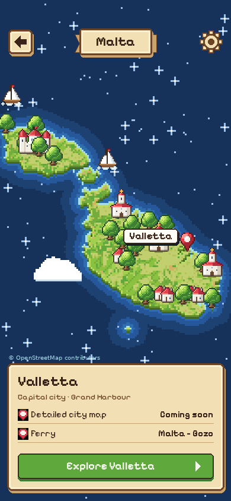

# Pixel World — Art Contract (draft 2.1)

Status: **draft for review, 10 November 2026.** Draft 2.1 replaces the simple icons with detailed, shaded ones drawn at a finer icon pixel. This covers task P2-06 for the continent and country scales that Phase 3 builds. Draft 2 moves the look much closer to the GlobeQuest concept image: night sea, raised game-board land, puzzle-piece countries, fewer and bigger icons, chunkier pixels, and parchment screen furniture. The capital scale is outlined here and gets its full rules in Phase 4. No app renderer implements these rules yet.

| Continent: Europe | Country: Malta |
| --- | --- |
|  |  |
| [Close-up](phase3/europe-continent-detail.png) | [Close-up](phase3/malta-country-detail.png) |

Icon sheet (enlarged): 

Regenerate the mockups with `.venv/bin/python scripts/art/phase3_mockups.py` (set up in the [README](../../README.md#phase-3-design-mockups)). That script is the reference implementation for every rule below. Its `P` table holds the palette tokens. Map icons come from `scripts/art/sprites.py`, which also writes the icon sheet (`.venv/bin/python scripts/art/sprites.py`).

## 1. Rules for every scale

- **One palette.** Every colour is a named token in the script's `P` table. Land greens are the globe's greens. The sea is the globe's deep blue, darkened (see §2). Third-party tiles are remapped to the palette, as `scripts/art/recolor_style_study.py` does for Ninja Adventure.
- **Pixel size.** Terrain pixels are **3 screen points** on phones. Icon pixels are **2 screen points**, so mountains, trees and buildings can carry the concept image's detail without crowding the map. Both are whole numbers, and each layer keeps a single pixel size. Detail comes from finer data, not from bigger pixels.
- **Flat ground, upright objects.** Ground is drawn flat, seen from above, with a raised "game board" edge (§2). Mountains, trees, houses, castles, boats and pins stand upright and are drawn back to front, top of the screen first.
- **Light from the upper left**, the same direction as the globe's lighting. Land is lit on its top and left coasts; upright sprites have a light left face and a shaded right face.
- **Icon shading.** Each material has 3–4 tones: highlight, light, mid and shade. Round forms (tree canopies, the pin) are shaded from a light vector, with a 2×2 ordered dither at tone edges and seeded specks for foliage. Buildings have a lit west column and shaded east columns, and roofs a lit west slope and shaded east slope with a highlight streak.
- **Outlines.** 1 pixel, in a dark shade of each material's own hue:

  | Material | Outline |
  | --- | --- |
  | Foliage | `#22472A` |
  | Rock | `#4A3222` |
  | Walls | `#4E4038` |
  | Roofs | `#5A1E28` |
  | Wood | `#3A2A20` |
  | Pin | `#4A1A20` |

  Ground has no outlines; edges come from colour steps.
- **Ground shadows.** Every icon sits on a soft shadow: black at 27% opacity, an ellipse about as wide as the icon.
- **Few, big icons.** A screen holds roughly 10–30 icons, not a carpet of them. Sizes in icon pixels, then points:

  | Icon | Icon pixels | Points |
  | --- | --- | --- |
  | Tree | 15×17 | 30×34 |
  | Pine | 13×18 | 26×36 |
  | Mountain | 21×18 | 42×36 |
  | Hill | 17×12 | 34×24 |
  | Castle | 27×24 | 54×48 |
  | Church | 19×25 | 38×50 |
  | House | 13×13 | 26×26 |
  | Sailboat | 17×19 | 34×38 |
  | Pin | 13×17 | 26×34 |
- **Stable decoration.** Noise, sparkles, clouds, boats and tree positions are seeded from longitude and latitude, never from screen position, so nothing shimmers while panning. Decoration is illustrative: it never adds named places.
- **Text and chips** are normal text in screen space, not baked into the art. Use Pixelify Sans. The selected place gets a red pin and a white name chip with an ink outline; selection never relies on colour alone.
- **Attribution.** OSM-derived scales show `© OpenStreetMap contributors` in the system font, because Pixelify Sans has no © glyph.

## 2. Sea and coasts (all scales)

The sea is a **night sea**, so the map stays continuous with the starry space scene the globe sits in. Water colour depends on distance from land, measured in **art pixels, not kilometres**, so the coast ring looks the same at every zoom.

| Distance (art px) | Token | Colour |
| --- | --- | --- |
| 1 | `edge_light` | `#A8DDEB` (pale outline around land) |
| 2–3 | `coast_band` | `#2E6DAF` |
| 4–6 | `sea_band` | `#25579A` |
| 7–11 | `night_band` | `#1D4272` |
| 12+ | `night` | `#16325A` |

- **Raised land.** Land pixels on a top or left coast use `land_hi` (`#B9DD63`). Under every south-facing coast, the two water pixels below become a cliff face: `cliff_top` (`#5F8A2C`), then `cliff` (`#41662A`).
- **Sparkles.** In open water (distance 6 or more), a 5×5 sparkle on about 0.12% of pixels and a single `sparkle` dot on about 0.3%.
- **Clouds.** Two puffy clouds per screen over open water: white with a flat `cloud_shade` base and no outline.
- **Lakes** large enough to read are `coast_band`. Rivers are omitted at continent scale, as in the concept image.
- **Small islands** always keep at least one land pixel, so small countries stay visible and selectable.

## 3. Scales

| Scale | Approx. ground per art pixel | Data | New at this scale |
| --- | --- | --- | --- |
| Earth (built) | varies over the sphere | Natural Earth 1:10m land and lakes, 1:50m borders | Sphere shading, clouds, atmosphere, space |
| Continent | ~20 km | + Natural Earth mountain ranges (scalerank ≤ 4) | Night sea, raised coasts, puzzle-piece countries, mountain and tree icons, selection glow |
| Country | ~0.3 km (Malta) | OpenStreetMap extract: coastline, land use, towns, ferries | Field patchwork, woods, houses and castles, sailboats |
| Capital (Phase 4) | ~0.01–0.02 km | OpenStreetMap streets, buildings, parks; curated landmarks | 16×16 tiles (Ninja Adventure, recoloured) and original landmark sprites |

All scales use the globe's orthographic projection, so zooming in keeps the same sphere and its curvature fades on its own. There is never a switch to a separate flat map. **Decided:** the globe's daytime ocean darkens gradually into the night sea while zooming in. In the app, one shader blends the globe into the board between zoom 1.5 and 2.5. Terrain pixels are 3 points at every zoom, so the pixel grid never changes size. Icons fade in over the second half of the blend.

## 4. Continent rules

- **Land colour** comes from decorative climate bands seeded from world coordinates, not measured land cover:
  - above 67°N: `tundra`;
  - 57–67°N: `boreal`;
  - 40–57°N: `grass`;
  - 33.5–40°N: `dry`;
  - below 33.5°N: `sand` with diagonal `dune` ridges.
- **Puzzle-piece countries.** Each country's land is lightened or darkened by up to 8%, chosen by a hash of the country. 1-pixel pale `border` lines (`#EEF5C8`) separate countries, never drawn on coasts.
- **Forest patches** (40–67°N): `forest` blobs from seeded noise. About 2.5% of other land pixels are `grass_light` or `grass_dark` specks.
- **Mountains.** Natural Earth ranges with scalerank ≤ 4 get 1–3 icons each (about one per 140 art pixels of range), at least 14 px apart. Major ranges (scalerank ≤ 3) use the snow-capped `mountain`; scalerank 4 uses `hill`.
- **Trees.** Up to 8 clumps of three trees in forest patches, at least 22 terrain px apart. Clumps are `pine` north of 55°N and `tree` elsewhere.
- **No capital icons and no country-name labels.** These were dropped in draft 2 to match the concept image's clean map. Names appear on the selection chip and in the card.
- **Selected country:**
  - fill `select_fill`, then a glow 1–3 pixels wide around it: `glow_in`, then `glow_out`, then lightened terrain;
  - countries under 40 pixels (Malta) also get a 2-pixel glowing ring of radius 7;
  - a red pin above the capital, with the name chip beside it.

## 5. Country rules

OpenStreetMap tags map to a small set of art classes. Later classes in this table draw over earlier ones. Land starts as a bright patchwork (`grass` and `grass_light` fields, seeded per world cell), and the classes adjust it:

| Class | OSM tags | Treatment |
| --- | --- | --- |
| farm | `landuse` = farmland, meadow, orchard, vineyard, farmyard, greenhouse_horticulture | Patchwork, with every fifth diagonal `grass_dark` |
| scrub | `natural` = scrub, heath, grassland; `landuse=grass`; `natural=bare_rock` | 75% `grass_dark`, 25% `dry`; may receive a few trees |
| wood, park | `natural=wood`, `landuse=forest`; `leisure` = park, garden, golf_course | `forest`, with tree icons |
| urban | `landuse` = residential, commercial, retail, industrial, construction | Pale `urban` green-gold; towns are shown by house icons, not texture |
| salt | `landuse=salt_pond` | `salt`/`edge_light` checkerboard |
| water | `natural=water`, `landuse=reservoir` | `coast_band`; ponds under ~3 art px are dropped (they read as noise) |
| beach | `natural` = beach, sand | `sand` |

- **Icons:**
  - up to 10 trees in woods and parks (8 px apart) and 6 on scrub (14 px apart);
  - in population order, at least 13 terrain px apart: a `castle` for each city other than the capital, a parish `church` for the three largest towns, and a pair of `house` icons for every other town;
  - the capital gets the pin and chip.
- **Roads are omitted**, as in the concept image. Domestic ferries under 20 km are a dashed `edge_light` line.
- **Boats.** Two sailboats, 5–14 px from the coast, at least 45 px apart.

## 6. Screen furniture

These are drawn in the mockups to show the target composition.

- **Header:** a parchment back button, a centred parchment title ribbon (Pixelify Sans Bold 22), and a parchment gear. Minimal back/focus controls belong to the Phase 3–4 visual work.
- **Bottom card:**
  - a parchment card from 612 points down;
  - a title (Bold 24), a subtitle, rows with a pin icon, and a green "Explore …" button;
  - only factual content (capital, islands, ferry). Progress percentages, XP and badges appear only once saved visits exist (Phases 5–6). The development plan forbids placeholder statistics.
- **Parchment colours:** `parchment`, `parchment_light`, `parchment_edge`, `parchment_shadow`, `ink`.

## 7. Open questions for review

1. ~~**Night sea versus the globe.**~~ Decided: the ocean darkens gradually as you zoom in (implemented).
2. **Malta at continent scale.** It's a 3×3 block plus a ring. Should small countries be drawn slightly enlarged at this scale?
3. **Bottom card height.** It covers the bottom 27% of the map. Should it be collapsible, starting as just the title and button?
4. **Rivers and roads** are gone (continent rivers, country roads) to match the concept image. Bring back major rivers?
5. **Status bar.** The mockups leave space for the phone's status bar, as the concept does. Confirm hidden or visible.

## 8. Sources and licenses

- **Natural Earth** (public domain): git revision `ca96624a`, checksums in `scripts/art/phase3-sources.lock.json`.
- **OpenStreetMap** (ODbL 1.0): Geofabrik Malta extract `malta-261108.osm.pbf`, SHA-256 `19bdaf3a…fe13`, cached in the git-ignored `.cache/osm/`. The mockups are produced works and carry the attribution.
- **Icons (`scripts/art/sprites.py`), clouds and parchment UI** in the mockups are original pixel art made for this project. Ninja Adventure tiles (CC0) are only used at the capital scale.
- **Pixelify Sans:** SIL Open Font License 1.1.
- **Reference:** the GlobeQuest concept image guides the style. Nothing from it is copied into project assets.
