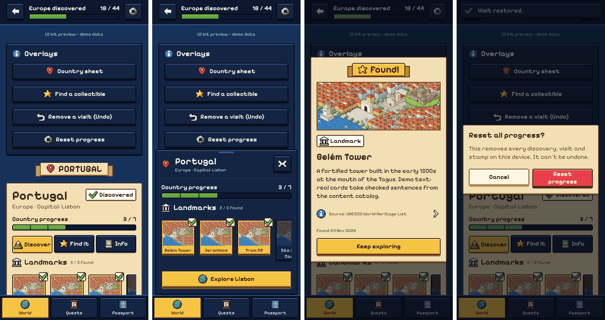
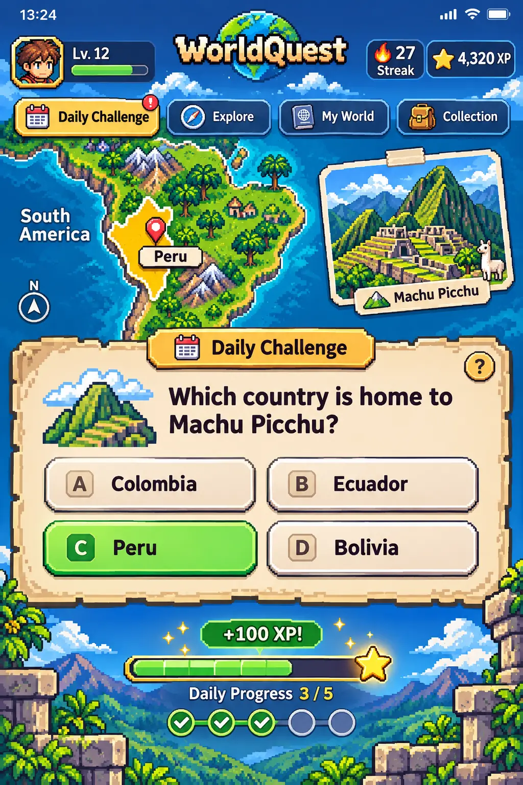
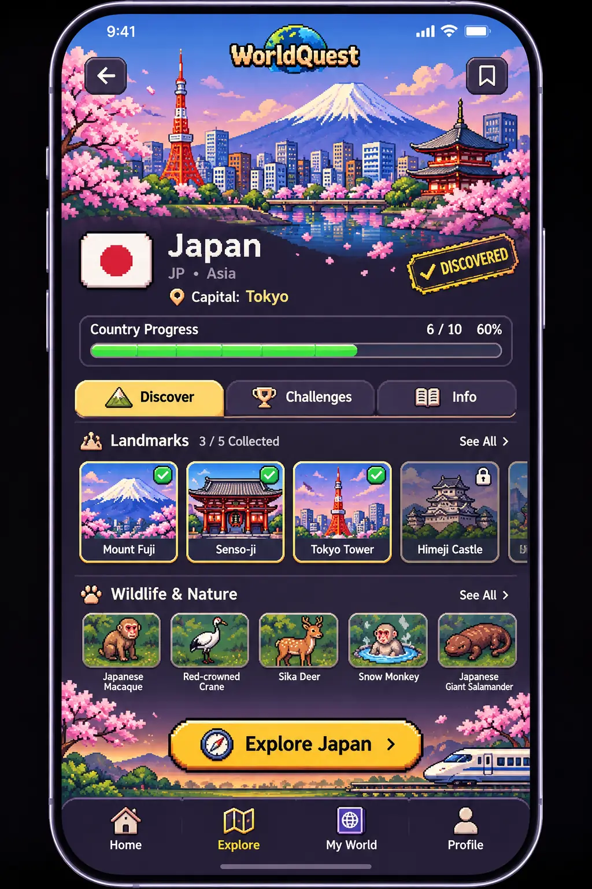
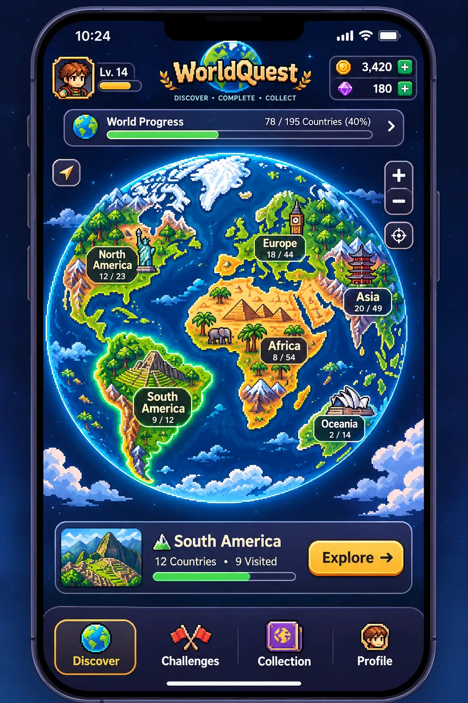
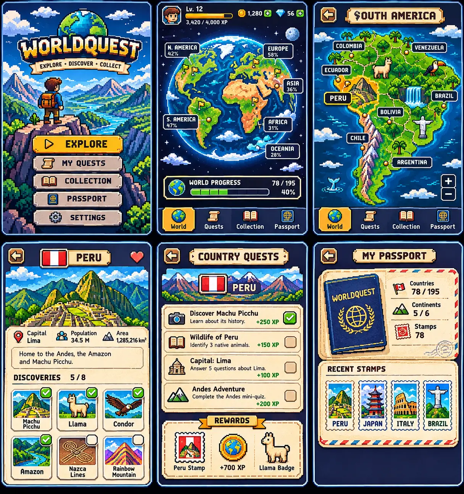

# Pixel UI Kit — the interface contract

Status: **v1.3, 25 November 2026.** This covers DEVELOPMENT_PLAN tasks P6-01 (tokens), P6-03 (components), P6-04 (`/ui-kit` route), P6-10 (title layer), and P7-01 (tabs and World progress). What is still missing, and which phase adds it, is in [Roadmap](#roadmap-what-the-kit-does-not-have-yet). Map art follows [ART_CONTRACT.md](../art/ART_CONTRACT.md). Everything drawn *over* the map follows this file.

Every agent (Codex, Claude) and every human building interface reads this before writing UI. The rules are enforced by `tests/ui-kit.test.mjs`; `npm test` fails when they are broken.

Live preview: run `npm run web` and open <http://localhost:8081/ui-kit>. The "Overlays" panel opens the title layer, a sheet, a found collectible, an Undo notice, and a confirm dialog. The "Find it" panel previews the prompt, miss feedback, and completion.

## Look we are aiming for

Visual reference (style only, see "What the mockups show that we do not build" below):

| Daily challenge | Country detail | World | Screen set |
| --- | --- | --- | --- |
|  |  |  |  |

What we take from them: chunky pixel frames with dark outlines and notched corners, a **night-navy frame** around a **cream parchment** content area, one **gold** call to action, **green** only for success and progress, Pixelify Sans everywhere, small pixel icons in the map's palette, the map always visible behind.

## The five rules

1. **Compose from the kit.** Screens import from `@/ui` and `@/constants/theme` only. Need something new? Add it to `src/ui/` (see "Adding a component"), never inline a one-off look in a screen.
2. **Tokens only.** No hex/rgb colours, `fontSize`, `fontFamily`, or `fontWeight` outside `src/constants/theme.ts`. Colours from `Palette`, spacing from `Space`, sizes from `Size`, text via `<PixelText variant tone>`.
3. **Whole UI pixels.** One UI pixel `U` = 2 points. Every border, gap, offset, and size is `px(n)`. No `borderRadius` (corners are notched by `PixelFrame`), no blur, gradients, soft shadows, `elevation`, or glass.
4. **One gold button per screen.** `variant="primary"` is the single main action. Everything else is `secondary` (cream) or `navy`. `success` (green) only shows a correct or completed state.
5. **Never colour alone, never fake numbers.** Every state carries a symbol or a number as well as a colour (check, lock, "3 / 7"). Every count has its real denominator and comes from saved records. Demo numbers live only in `/ui-kit`.

## Tokens (`src/constants/theme.ts`)

| Token | What it is |
| --- | --- |
| `U`, `px(n)` | 2 pt per UI pixel; `px(3)` = 6 pt |
| `Palette` | All colours. Navy frame (`space`, `night`, `navyDeep`, `navy`, `navyRaised`, `navyEdge`, `navyInk`), parchment (`parchment`, `parchmentLight`, `parchmentShadow`, `parchmentEdge`, `cream`, `creamShade`), `gold*`, `green*`, `red*`, text (`ink`, `inkSoft`, `snow`, `mist`, `muted`) |
| `Frames` | Skins for `PixelFrame`: `parchment`, `navy`, `gold`, `cream`, `green`, `red` (destructive only), `chip`, `track` (outline, fill, highlight, shade, lip) |
| `Space` | `xs` 4, `sm` 8, `md` 12, `lg` 16, `xl` 24, `xxl` 32 pt |
| `Size` | `touch` 48 pt minimum target, `icon` 24 pt, `buttonDepth` 2 U, `panelDepth` 1 U, `maxContentWidth` |
| `Type` | `display` 32, `title` 24, `heading` 20, `label` 16 (bold), `body` 16, `caption` 12 |
| `Motion` | `frameMs` (one frame at 12 fps), notice durations, `sheetMaxShare` (0.5 of the screen) |
| `PixelFonts` | Pixelify Sans regular/bold, loaded by the root layout |

Palette hues match the map art (`scripts/art/phase3_mockups.py` `P`, `scripts/art/sprites.py`). Change a colour in one place and both stay consistent: if you change a map hue, update the token too.

The native splash and Android adaptive icon background use `Palette.night`. Expo reads the hex value from `app.json`. Keep it in sync with the token when changing the palette.

## Components (`src/ui/`)

| Component | Use it for | Notes |
| --- | --- | --- |
| `Screen` | The outer layout of every screen | `header` (usually a `TopBar`), `footer`, `overlay` (a `BottomSheet`), `scroll`, `background` `night`/`space`/`none`. Use `fullBleed` with `scroll={false}` for a scene that fills the tab viewport with an overlaid header. `floatingHeader` insets that header over the scene. Use `bottomInset={false}` when the navigator already reserves the bottom safe area |
| `TitleLayer` | Launch title over a live scene | Put it in the full-bleed `Screen` overlay. Pass the logo asset, label and dimensions in artwork pixels, the tagline, and `onExplore`. The callback runs at the end of the stepped exit, or immediately with reduced motion |
| `TopBar` | Map headings and navigation | `onBack` with optional `backLabel`, `title` or progress as children, `actions` on the right. `compact` fits a single line. Use `ribbon` in a floating header for a cream back button and centred parchment title |
| `ChallengePrompt` | Find-it prompt in the capital `TopBar` | `title`, optional `feedback`, `misses` to replay the whole-pixel shake with `useSteps`, `complete` for the green check and completion text. Reduce motion keeps the bar still |
| `BottomSheet` | Country and place details over the map | Controlled `expanded`/`onExpandedChange`, `onClose`, `action` (the screen's one primary button). Tap or swipe the header. An optional `artwork` sits above the expanded content. Expanded details scroll within half the screen. Put it in `Screen`'s `overlay` |
| `PixelModal` | A centred dialog over the dimmed world | `visible`, `onClose` (backdrop and Android back), `label`. Pops in with a stepped scale. The dialog fits inside the safe area and its contents scroll when tall |
| `CollectibleCard` | Collectible details inside a `PixelModal` | `name`, `kind` (`landmark`/`wildlife`/`landscape`), `image`, `imageFit="contain"` to show the full crop, `description`, `source` (always shown), `foundOn`, `justFound` (gold "Found!" ribbon) |
| `ConfirmDialog` | Asking before an action that loses records | Name the action on the button; `destructive` makes it red. Prefer an Undo notice when the action can be reversed |
| `NoticeProvider` / `useNotice` | Short messages: "Visit removed." with **Undo**, save failures | Mounted once in the root layout. `useNotice()({ message, icon, action })`. One at a time, at the top, announced to screen readers |
| `useSteps` | Stepped animations | `useSteps(frames, trigger)` returns the current frame at 12 fps; reduce motion returns the last frame |
| `PixelFrame` | The primitive behind everything: outline, notched corners, fill, highlight, shade, lip | `skin`, `depth` (UI px), `pressed`. The frame takes its height from its content on native and web. Use directly only inside `src/ui/` |
| `PixelText` | All text | `variant` from `Type`, `tone`: `ink`/`inkSoft` on parchment, `light`/`lightSoft` on navy, `outlined` over the map |
| `PixelIcon` | 12×12 pixel icons, 24 pt | `name` from `IconName`. Decorative; label the control around it |
| `PixelButton` | Actions | `variant` `primary`/`secondary`/`success`/`navy`/`danger` (destructive confirm only), `icon`, `marker` (A/B/C), `block`, `disabled`. Sinks 2 U when pressed |
| `IconButton` | Back, close, zoom, help | `accessibilityLabel` is required |
| `Panel` | Content cards (`parchment`) and sheets over the map (`navy`) | Column with `Space.md` gaps |
| `SectionHeader` | Row title in a panel: icon, title, count, action | `count` like "3 / 5 found" |
| `Divider` | 1 U rule between rows | |
| `Ribbon` | Screen or block title banner | `parchment` for titles, `gold` for a featured block. Use `variant="label"` for a compact banner |
| `Chip` | Place names, continent labels and tags | `light` over the map, `navy` with optional `detail`, `gold` selected. Use `compact` where map space is limited. With `onPress`, it has a 48 pt button target and accepts an `accessibilityLabel`. Pass `mapTap` to coordinate the chip and its map's tap, pan and pinch gestures |
| `ProgressBar` | Segmented green bar with its count | `title`, `value`, `total`, `tone`, optional `icon` to the left. Use `compact` for the title and count in one row. Total 0 shows "Coming soon", never complete |
| `StepDots` | Short goals ("today 3 / 5") | Pair with a visible count |
| `SegmentedTabs` | Sections inside a screen (Discover / Find it / Info) | Selected is gold |
| `TabBar` | The app's bottom tabs | Matches item keys to the router's registered `TabTrigger` names and displays the focused tab. `/ui-kit` supplies local selection props to preview the same buttons |
| `CollectibleTile` | Landmark/wildlife/landscape cards | `state` `found` (gold + check), `missing` (dimmed), `locked` (lock, name hidden). Use `compact` for sheet rows and `imageFit="contain"` to keep the whole crop visible |
| `Badge` | Icon pinned to a tile corner | |
| `QuestRow` | One challenge in a list | `done` shows a green check box, `progress` like "1 / 3 animals" |

## Screen recipes

- **Every screen** is a `Screen`. The map uses `background="none"`, `scroll={false}`, and `fullBleed` so headers and sheets lay over the map inside the tab viewport. Other screens use `night`. Content sits on `Panel`s.
- **Launch:** `WorldTitle` uses `TitleLayer` for the logo, parchment tagline, and one gold **Explore** button, with the centre open for the spinning globe. The world screen disables map input while the layer is visible. Explore releases input after the exit and eases the globe back to the opening camera. Camera deep links skip the title.
- **World progress:** after Explore, the Earth overview shows `Countries completed` in a floating navy `Panel` with the globe icon, track and `n / N`. The total comes from catalog countries with released content. A country counts as completed when every checked collectible in its pack has a discovery record. These records last for the current session until P5-07 adds persistence. The count moves to a compact `TopBar` during the zoom toward the continent.
- **Continent labels:** compact navy `Chip`s follow the globe below zoom 0.6. They show continent names, yield to each other when space is tight, and let map gestures pass through. The launch title leaves the globe clear of labels.
- **Regional headers:** at continent and country zoom, a floating cream Back button and parchment ribbon name the place under the camera centre. Use a tier label over open water. Compact navy country names appear on the continent board. A selected country gets a gold outline and its sheet supplies the heading. On the country map, a cream chip with a pin names a visible capital with a scene. Prefer the selected country's capital or the country under the camera centre when its capital is visible. The capital scene keeps the usual navy header with Back and the title or find-it prompt.
- **Sheets over the map:** `BottomSheet` in the `Screen`'s `overlay`, so the map stays mounted and the camera never resets. Collapsed: title and the one primary action. Expanded: details, at most half the screen.
- **Finding something:** open a `PixelModal` with `CollectibleCard justFound`. The card's button is the only gold one while it is open.
- **Undo, not "Are you sure?":** reversible actions (remove a visit, un-wishlist) happen at once and show a notice with Undo. Only irreversible ones (reset all progress) use `ConfirmDialog`.
- The **country sheet** (P5-03) shows a title, “Continent · Capital: Name” and one primary **Explore** button. Expand to see a panorama from the existing capital scene, a parchment **Country progress** panel, and compact **Landmarks** tiles with crops from the same scene. Found tiles and the count read the same discovery records as the challenge. An empty released pack shows **Coming soon**. See [progress rules](../content/CATALOG.md#fact-review-and-progress).
- At full capital zoom, **Find it** places a `ChallengePrompt` in the `TopBar`. A miss shakes the bar for a few frames and adds encouragement. After three misses the feedback names the area and the map draws pixel brackets. A correct tap opens a card and the prompt advances when the card closes. The final banner shows the number of checked landmarks found.
- **Lists:** `QuestRow`s with `Space.md` gaps.
- **Layout width:** `maxWidth: Size.maxContentWidth`, centred, so tablets and web don't stretch panels.
- **Safe areas:** `SafeAreaView` from `react-native-safe-area-context`; the tab bar sits in the bottom inset.

## Navigation

Per [PROJECT_VISION.md](../../PROJECT_VISION.md): three tabs, **World** (the map), **Quests**, **Passport**. The collection lives inside Passport. Country and collectible details open as sheets over the map.

At country zoom, tap the capital label to enter its scene or keep pinching toward it to zoom in. Tap the country to open its sheet, or tap open sea or press Close to clear the selection. The label and the sheet's Explore button focus the capital on the same map, and Back after either action restores the previous country view. From a country or continent, Back zooms out around the current location.

`GameTabs` uses the SDK 58 custom tabs API from `expo-router/ui`. Its hidden `TabList` registers the three routes. The visible `TabBar` uses `TabTrigger asChild` for each pixel button and sits inside the bottom safe area. The title reveals the bar after Explore finishes the launch exit. Camera deep links go directly to World with the tabs.

`TabSlot` keeps visited tabs laid out at full size and hides their views when inactive. This keeps the Skia drawing surface sized while World pauses its animation clock. The same canvas, camera, country sheet and find-it state are available on return. Quests and Passport show short previews of upcoming content, and Passport counts landmarks found in the current session.

The tabs API is experimental. Read the matching SDK reference before changing the navigator. [Expo custom tabs](https://docs.expo.dev/router/advanced/custom-tabs/)

## Motion, sound, haptics

- **Stepped, not smooth.** State changes jump between frames (button press = 1 step down, sheet open = one step). Short frame animations run at 12 frames per second with `useSteps`, never with easing curves: the dialog pop is `[0.85, 1.05, 1]`, the notice slide `[-8, -2, 0]` UI px.
- **Reduce motion:** `useSteps` returns the last frame when the OS setting is on. Anything animated without it must check `useReducedMotion` from `react-native-reanimated`.
- **Haptics** (P6-06): not installed yet. When added, `npx expo install expo-haptics`; a light impact on primary presses and finds only.

## Accessibility

- Touch targets at least `Size.touch` (48 pt). Buttons get `accessibilityRole="button"` and a label (the kit does this).
- Icon-only controls require `accessibilityLabel`.
- The title logo receives initial focus and carries the app name as its image label. On web, Explore transfers focus to the map after the exit.
- A new `BottomSheet` title is announced on native and receives keyboard focus on web. Its title button toggles the details, and Close and Explore have separate buttons.
- `ChallengePrompt` uses a polite live region for the prompt and feedback. With the map focused on web, arrow keys pan and Enter tries the center point.
- Progress uses `accessibilityRole="progressbar"` with min/max/now (the kit does this).
- Text never smaller than `caption` (12 pt). Body font for long text is an open decision (Pixelify Sans vs. a plainer companion); keep long text short until it is settled.

## Icons

Icons are 12×12 palette-letter grids in `scripts/art/build_ui_icons.py`. To add or change one:

1. Edit `ICONS` (12 rows of 12 characters; letters from `COLORS`; outline with `o`; light from the upper left).
2. Run `.venv/bin/python scripts/art/build_ui_icons.py`. It writes `assets/ui/icons/<name>.png`, `@2x`, `@3x` (pre-scaled, so pixels stay sharp on every density) and `src/ui/icons.generated.ts`.
3. Check it in `/ui-kit` (the icon grid lists every icon).

Do not use `expo-symbols`, `@expo/vector-icons`, or emoji in game UI.

## Adding a component

1. Check this table first; extend an existing component with a prop before adding a new one.
2. Build it in `src/ui/<Name>.tsx` from `PixelFrame`, `PixelText`, `PixelIcon` and tokens. Export it from `src/ui/index.ts`.
3. Give it accessibility roles/labels and a 48 pt target if it is pressable.
4. Add it to `src/features/ui-kit/UiKitView.tsx` and to the table above.
5. Run `npm test`, `npm run lint`, `npm run typecheck`, then look at `/ui-kit` at 390×844.

## Roadmap: what the kit does not have yet

Add each when its phase starts, following "Adding a component". Do not style these inside a screen in the meantime.

| Needed for | Missing | Phase |
| --- | --- | --- |
| Launch | A gesture hint that stays until the player acts | P6-11 |
| Passport and travel | `Stamp`, stamp grid, list rows (visited places), wishlist toggle, date picker for visits, search field for the home country | P7-04 to P7-06 |
| Settings | `Toggle` (mute, reduce motion), link rows (attribution) | P6-06, P8 |
| Game feel | Stamp slam, clouds clearing, haptics on primary presses and finds, sounds | P6-06, P7-02 |
| Icons | Share, calendar, heart (wishlist), stamp, search, flag, trophy, sound on/off | When used |
| Accessibility | A large-text rule: fixed type sizes can overflow fixed boxes (step dots, icon buttons, quest check box) | P6-08 |

## What the mockups show that we do not build

The reference images are a style target. Several things in them conflict with the agreed [PROJECT_VISION.md](../../PROJECT_VISION.md); the vision wins until the owner changes it there.

| In the mockups | Decision |
| --- | --- |
| Coins, gems, "+" shop buttons | Excluded: no currencies or shops |
| XP, levels, "+100 XP", "+250 XP" rewards | Deferred until playtesting (P5-08). Show honest counts ("3 / 7") instead |
| Avatar portrait, profile tab | Excluded in the first release |
| Streak flame | Not in v1. If added later, it rewards and never punishes |
| Multiple-choice trivia ("Which country is home to Machu Picchu?") | Challenges are "find it" taps and map questions answered on the map |
| Four tabs (World / Quests / Collection / Passport) | Three: World / Quests / Passport (collection inside Passport) |
| Peru, Japan, South America content | The first release covers Europe, where capital scenes exist |
| Logo in the reference | The Earthia logo is generated by a script from one name string (P6-10) |
| Illustrated title screen with an explorer and a five-button menu | Title over the live, spinning globe with one Explore button (P6-10). The menu would repeat the tab bar, and the explorer is avatar territory |

## Known limits of v1

- Frames are drawn with Views, not nine-slice PNGs; they have no paper grain or torn edges. A texture layer can be added inside `PixelFrame` later without changing any screen.
- Fractional percentages in `ProgressBar` can land between device pixels.
- Checked in Chrome at 390×844 only, including each overlay (sheet collapsed and expanded, found card, notice and Undo, confirm). Physical iPhone/Android checks are pending (P6-04): the sheet's swipe, Android back on dialogs, screen-reader focus in dialogs, and safe areas need a real phone.
- A notice shown while a `PixelModal` is open is hidden under the dialog (React Native modals sit above everything). Close the dialog first, then notify.
- `CollectibleTile` images in `/ui-kit` are whole capital scenes; real tiles need landmark crops from P5-01/P5-06.
